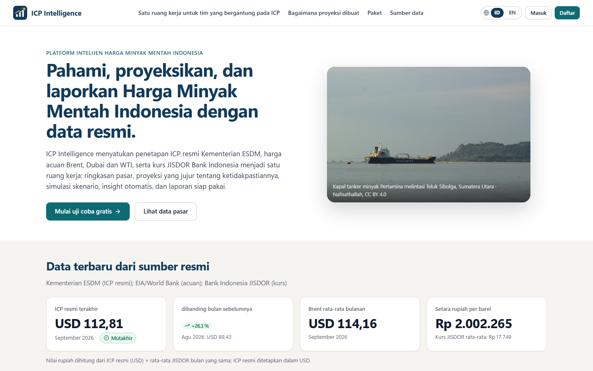
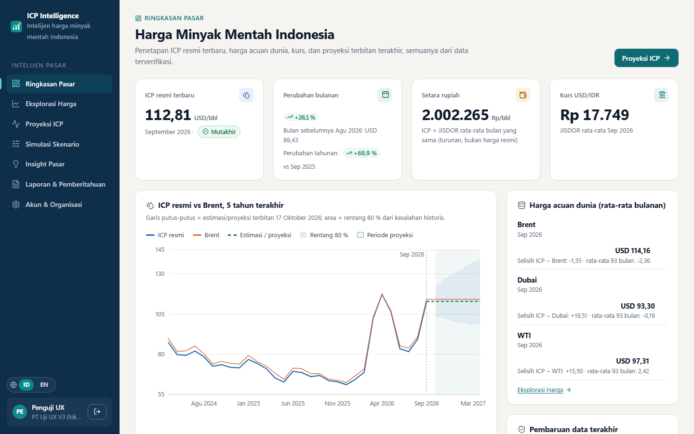
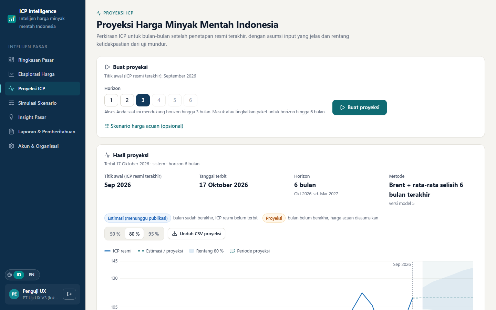
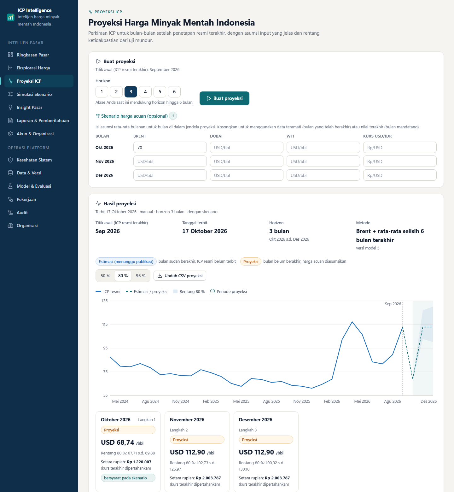
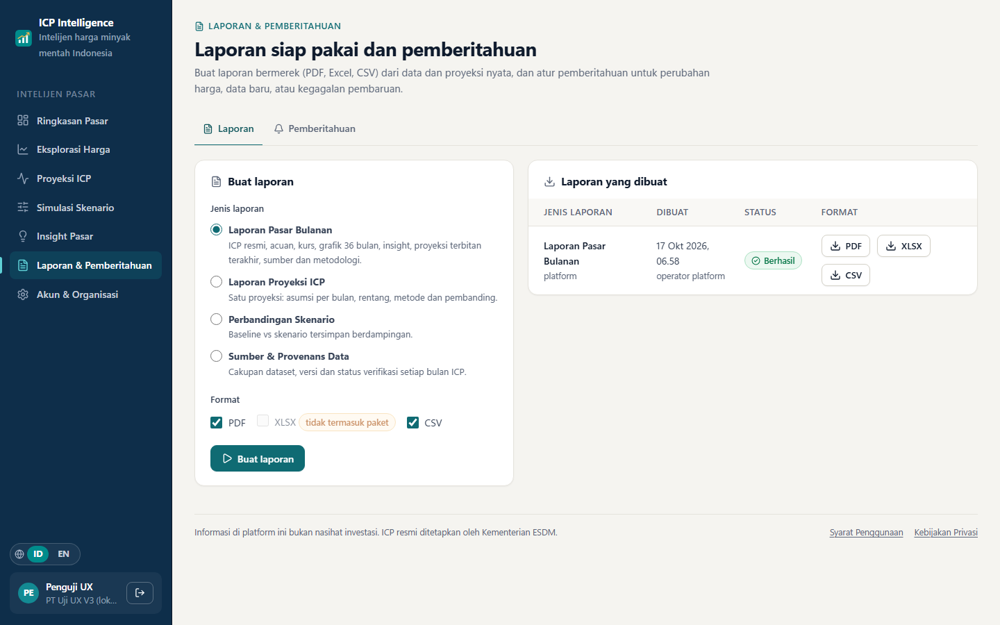
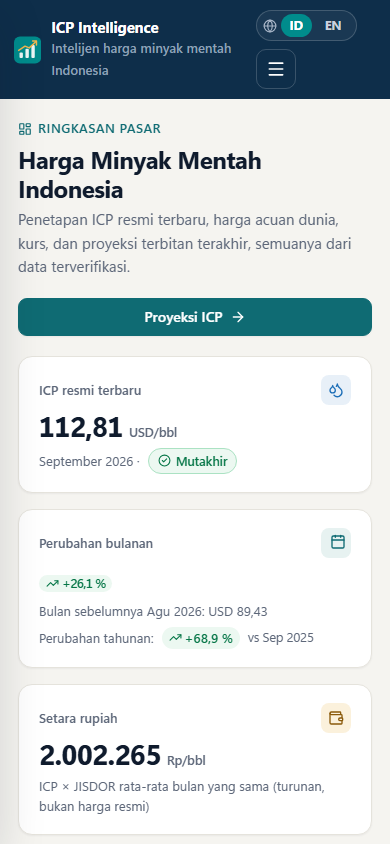
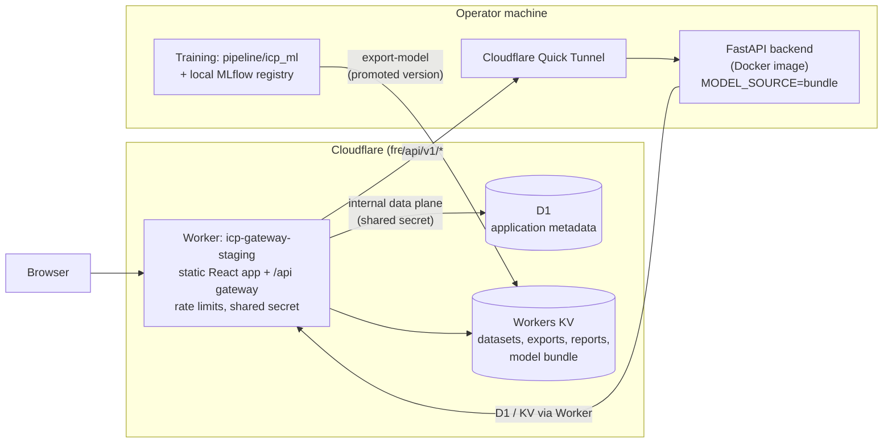

# ICP Intelligence

A web application for analysing and forecasting the **Indonesian Crude Price (ICP)**, the official
monthly crude oil price set by Indonesia's Ministry of Energy and Mineral Resources (ESDM). It
combines the official ICP series with world benchmarks (Brent, Dubai, WTI) and the USD/IDR exchange
rate, and offers market summaries, price exploration, forecasts with uncertainty ranges, scenario
analysis, rule-based insights and downloadable reports.

ICP is used in Indonesian budgeting, oil and gas revenue sharing and energy planning, but the
official value for a month is published only in the following month, in decrees and announcements
that are not available as a clean data series. The project addresses three problems:

- rebuilding a **trustworthy official series** from ESDM's own documents, with per-month evidence;
- estimating the value of months that have ended but are **not yet published**, and projecting
  future months under **explicit benchmark assumptions**;
- presenting the results to analysts in energy, finance and planning teams with the uncertainty
  and the assumptions visible.

The user interface is in Indonesian by default, with an English toggle.

## Project status

This is a **portfolio project with a public staging deployment**, not a production service.

- The web app, API gateway and storage run on Cloudflare's free plan.
- The Python backend runs as a Docker container on the author's machine and is exposed through a
  **Cloudflare Quick Tunnel**. When that machine is off or the process stops, every feature that
  needs the API is unavailable; the tunnel hostname also changes on each restart.
- There is no uptime guarantee, no monitoring with alerting and no load testing.
- Payment, e-mail delivery and several account features are not implemented
  (see [Known limitations](#known-limitations)).

## Live demo

**Staging:** https://icp-gateway-staging.icp-gateway.workers.dev

The landing page and static assets are always served by Cloudflare. Market data, forecasts,
sign-in and all other API features work only while the self-hosted backend is running; otherwise
the app shows a "data service unavailable" message instead of figures. Anyone can register a
trial organisation from the landing page.

When the backend was online on 2026-10-17, the following passed against the public URL: the
repository smoke test (11 of 11 checks) and an end-to-end feature check (18 of 18: registration,
sign-in, market summary, price history, forecast with a scenario, CSV export, saving and comparing
scenarios, PDF/CSV report generation and download, access control on private and internal routes,
sign-out).

## Key features

| Area | What it does |
|---|---|
| Market summary | Latest official ICP, monthly and yearly change, Brent/Dubai/WTI, JISDOR USD/IDR, rupiah equivalent, data freshness |
| Price exploration | ICP vs a chosen benchmark over 1, 3, 5 years or all, ICP-benchmark spread, rupiah view, missing months shown as gaps, CSV download, per-month verification status |
| Forecasts | 1-6 month horizon from the latest official month; "estimate awaiting publication" vs "future forecast" labels; empirical 50/80/95 % ranges; per-month input assumptions with their source; forecast history and CSV export |
| Scenarios | Saved benchmark/FX assumptions per month, compared side by side (up to four) against a no-assumption baseline |
| Insights | Rule-based observations (material changes, unusual spreads, FX context, forecast shifts, data quality), each traceable to a dataset version |
| Reports and alerts | Branded PDF, Excel and CSV reports (monthly market, forecast, scenario comparison, data provenance); alert rules with an in-app inbox |
| Accounts | Self-service organisation sign-up (trial plan), members and roles, API keys, plan entitlements enforced on the server |
| Platform operations | Operator area for dataset versions and source evidence, model evaluation and promotion, background jobs, system health, audit log, tenant administration |

Feature availability depends on the plan (for example, the trial plan limits the forecast horizon
to three months and report formats to PDF and CSV).

## Screenshots

| Landing page | Market summary |
|---|---|
|  |  |

| Forecast | Forecast with a benchmark scenario |
|---|---|
|  |  |

| Reports | Mobile (390 px) |
|---|---|
|  |  |

Screenshots were taken from the local application with test accounts. More captures, including
the operator area and error states, are in [docs/screenshots/](docs/screenshots/).

## System architecture



**Serving path.** The browser only talks to the Worker. The Worker serves the React build and
forwards `/api/v1/*` to the backend with a shared secret; the backend rejects requests that did
not come through the gateway. The backend keeps no state of its own: it reads and writes metadata
in D1 and objects in KV through secret-protected internal routes on the same Worker. Forecasts are
computed from an **exported model bundle** (model v5), so no MLflow server runs online.

**Training path.** Training, validation and promotion happen on the operator machine with the
`pipeline/icp_ml` package and a local MLflow registry. A promoted version is exported as a bundle
with `icp-api export-model`; the staging backend refuses training and promotion requests.

Locally, the same code runs on SQLite and a filesystem object store under `var/`. The code also
supports the D1 REST API, S3-compatible object storage and a PostgreSQL MLflow store; those
options are not used by the current deployment. Details: [docs/ARCHITECTURE.md](docs/ARCHITECTURE.md),
[docs/DEPLOYMENT.md](docs/DEPLOYMENT.md).

## Technology stack

| Layer | Technologies |
|---|---|
| Frontend | React 19, TypeScript, Vite, React Router, Recharts, Lucide icons |
| Gateway and hosting | Cloudflare Workers (static assets, rate limiting), Wrangler, Cloudflare Quick Tunnel |
| Backend | Python 3.10-3.12, FastAPI, Pydantic, Uvicorn, ReportLab and openpyxl for reports |
| Data engineering | pandas, httpx, PyMuPDF and Tesseract OCR for ESDM decrees, DVC for the original raw files |
| Machine learning | scikit-learn, skops model serialisation, MLflow tracking and registry |
| Storage | SQLite (local), Cloudflare D1 and Workers KV (staging) |
| Quality | pytest, Vitest and Testing Library, ruff, mypy, ESLint, OpenAPI contract with generated TypeScript types |
| Packaging | npm workspaces, Docker |

## Data sources and methodology

| Dataset | Source | Notes |
|---|---|---|
| ICP (official) | ESDM monthly ministerial decrees and announcements | Reconciled per month; see below |
| WTI, Brent | U.S. EIA spot series (API, or a public mirror of the same release) | Daily values averaged per month; public domain |
| Dubai | World Bank Commodity Markets "Pink Sheet" | Monthly; CC BY 4.0 |
| USD/IDR | Bank Indonesia JISDOR reference rate | Daily values averaged per month |

**Reconciliation.** Each ICP month is read from the decree (text layer or OCR) and from the
announcement, and the values are compared. A month is accepted when sources agree, flagged when it
rests on a single source, and blocked when sources conflict. The reconciled local dataset covers
2019-01 to 2026-09 (93 months, no gaps): 86 months confirmed by two sources, 6 by the announcement
only and 1 by OCR only. The process corrected four values in the original CSV and filled 14
missing months. Evidence and policy: [docs/DATA_RECONCILIATION.md](docs/DATA_RECONCILIATION.md).

**Principles.** Missing months are shown as gaps and never interpolated; partial months never enter
a dataset; official values, estimates and forecasts are labelled differently in the data and the
UI; every forecast records its origin month, issue date, model version, dataset versions and the
source of each input (observed, user scenario, or last value held). Sources and licences:
[docs/DATA_SOURCES.md](docs/DATA_SOURCES.md), [docs/DATA_DICTIONARY.md](docs/DATA_DICTIONARY.md).

## Machine learning and evaluation

Several transparent methods are compared: persistence (last official value), benchmark plus
average spread rules, a non-negative benchmark blend, ridge regression and gradient boosting. Each
is evaluated with a **rolling-origin backtest** (69 origins, 2020-12 to 2026-08) for horizons of
1-6 months, in two situations:

- **observed**: the target month's benchmark averages are known (a month that has ended but whose
  ICP is not yet published);
- **hold-last**: benchmarks are unknown and held at their last value (a genuinely future month
  without a user scenario).

Mean absolute error in USD per barrel, on the comparison set common to all methods:

| Method | Observed, 1 month | Observed, 3 months | Hold-last, 1 month | Hold-last, 3 months |
|---|---|---|---|---|
| Persistence (baseline) | 6.09 | 10.66 | 6.09 | 10.66 |
| WTI + average spread (previous baseline) | 2.00 | 2.01 | 6.17 | 10.25 |
| **Brent + 6-month spread (production v5)** | **0.85** | **1.00** | 6.12 | 10.60 |
| Gradient boosting (previous production family) | 2.35 | 3.66 | 6.16 | 10.64 |

How to read this:

- When the month's benchmarks are known, the selected rule explains ICP closely: about 0.85 USD/bbl
  at one month versus 6.09 for persistence.
- For future months without a benchmark view, **no method beats persistence**. The app therefore
  presents future months as conditional on the benchmark assumption, and the forecast is only as
  good as the scenario the user enters.
- Prediction ranges are empirical quantiles of backtest errors. Out-of-sample 80 % coverage is
  0.96-1.00 in the observed situation but drops to 0.65 at three months in the hold-last situation,
  so the future-month ranges understate risk in volatile periods.
- Promotion to production requires, among other gates, beating persistence when benchmarks are
  known, staying within 10 % of persistence without them, and not being more than 5 % worse than the
  current production model; the gates and model cards are described in
  [docs/FORECASTING_METHODOLOGY.md](docs/FORECASTING_METHODOLOGY.md).

The history is short (monthly data from 2019) and dominated by regime changes such as 2020 and
2022, so these figures describe this period, not a general accuracy level.

## Repository structure

```
apps/web/            React single-page app (pages, components, i18n, brand assets in public/)
apps/gateway/        Cloudflare Worker: static assets, /api gateway, internal D1/KV data plane
backend/icp_api/     FastAPI application: routers, services, storage adapters, security, CLI
backend/tests/       API, storage, jobs, accounts and product tests
pipeline/icp_ml/     Data sources and parsers, features, forecasting methods, backtest, training,
                     registry, model bundle; configs/training.yaml
pipeline/tests/      Pipeline tests
packages/contracts/  OpenAPI document and generated TypeScript types
infra/               D1 migrations, Docker image, monitoring profile, Render notes (not in use)
data/                Original ICP CSV, DVC pointers for raw files, seed CSVs for benchmarks and FX
docs/                Architecture, data, methodology, API, security, deployment, operations, reports
scripts/             Cross-platform setup, dev, smoke test, contract check, secret scan, staging helper
legacy/              The previous Streamlit application and course evidence (reference only)
```

## Getting started

### Prerequisites

- Node.js 22.12 or newer
- Python 3.10, 3.11 or 3.12
- Optional: Docker, and Tesseract OCR for scanned ESDM decrees

### Install and run locally

`data/raw/wti.csv` is tracked with DVC and no public DVC remote is configured, so a fresh clone uses
the WTI file shipped in `data/seed/` instead:

```bash
npm install
SEED_WTI_PATH=data/seed/wti.csv npm run setup     # PowerShell: $env:SEED_WTI_PATH="data/seed/wti.csv"; npm run setup
npm run dev                                       # API on :8000, web app on http://localhost:5173
```

`npm run setup` creates the Python virtual environment, generates local secrets into `.env` and
`apps/gateway/.dev.vars` (both gitignored), applies the database migrations, seeds the datasets,
trains and promotes a first model (about 1-3 minutes), generates the contract types and builds the
web app. `npm run setup -- --skip-train` skips the training step.

A fresh setup seeds ICP from the original repository CSV (2019-01 to 2026-03, including the values
later corrected). To build the reconciled official series, run the ESDM ingestion; it downloads
and parses the decree archive, can take a long time and needs Tesseract for scanned decrees:

```bash
node scripts/py.mjs -m icp_api.cli ingest icp --full
```

Other useful commands:

| Command | Purpose |
|---|---|
| `npm run dev:edge` | Backend plus the production build behind the real Worker (`wrangler dev`, port 8787) |
| `npm run stop` | Stop the dev stack |
| `npm run smoke -- <url>` | Smoke test against a running stack (default `http://127.0.0.1:8787`) |
| `node scripts/py.mjs -m icp_api.cli ingest benchmarks` / `fx` | Refresh benchmark and FX data from the public sources |
| `node scripts/py.mjs -m icp_ml.cli backtest` | Rolling-origin backtest of every configured method |
| `npm run mlflow:ui` | MLflow UI on port 5000 |

The operator token for the Platform Operations area is in `.env` (`ADMIN_API_TOKENS`); use the
operator tab on the sign-in page ("Masuk sebagai operator"). Business users register an organisation from the
landing page.

### Staging deployment (Quick Tunnel)

Staging needs a Cloudflare account, the D1 database and KV namespace configured in
`apps/gateway/wrangler.jsonc`, and the staging variables in a local, gitignored env file. With those
in place:

```bash
npm run staging:backend     # starts the backend container, opens a Quick Tunnel, deploys the Worker
```

Keep the process running. The tunnel hostname is stored only in a gitignored local file and passed
to Wrangler at deploy time; a plain `wrangler deploy --env staging` deploys a placeholder backend
URL. The full runbook, free-tier limits and the alternatives that were evaluated are in
[docs/DEPLOYMENT.md](docs/DEPLOYMENT.md) and [docs/HOSTING_REPORT_2026-10.md](docs/HOSTING_REPORT_2026-10.md).

## Testing and quality

```bash
npm test          # pytest, plus Vitest for the web app and the gateway
npm run check     # lint, type checks, OpenAPI contract drift, all tests, builds, secret scan
```

Last full run (`npm run check`, 2026-10-17): ruff, mypy and ESLint clean; contract in sync;
**96 Python tests, 27 web tests and 20 gateway tests passed**; web and Worker builds succeeded;
secret scan without findings.

The tests cover the API, storage adapters (SQLite and a simulated D1 protocol), the gateway's
internal data plane, accounts and entitlements, forecasting semantics, prediction equality between
MLflow and bundle mode, and the web app's session flows (sign-in, deep links, sign-out, session
expiry, offline errors). Browser checks with headless Chrome were run locally against all main
pages at desktop and mobile widths. The tests run against local stores and simulated services;
apart from the staging checks listed under [Live demo](#live-demo), they do not exercise the
deployed environment.

## Security and configuration

- Secrets are never committed. Local secrets are generated into `.env` and
  `apps/gateway/.dev.vars`; staging secrets are set with `wrangler secret put` and kept in a
  gitignored local folder. `.env.example` and `.dev.vars.example` contain placeholders only.
- The browser never sees a backend URL or secret. The gateway adds a shared secret that the backend
  requires; the Worker's internal D1/KV routes reject requests without it.
- Users authenticate with server-side sessions; roles, plans and organisation boundaries are
  enforced by the backend. Operator access uses separate tokens.
- A secret scan runs as part of `npm run check`.

No formal security audit or penetration test has been carried out. See
[docs/SECURITY.md](docs/SECURITY.md).

## Known limitations

**Current deployment**
- The backend runs on a personal machine behind a Quick Tunnel, which Cloudflare describes as
  having no uptime guarantee and as intended for testing. The API is offline whenever that machine
  or process is.
- Free-tier quotas apply (for example Workers KV allows 1,000 writes per day; every report,
  forecast export and dataset version uses writes). Limits stop the service rather than incur cost.
- The public market snapshot takes about five seconds on staging because of many storage round
  trips through the Worker.
- Continuous training through GitHub Actions is not active: the staging backend serves a bundle
  and refuses training jobs.

**Product**
- No payment integration; plans are changed by an operator.
- No e-mail delivery: alerts are in-app only, and invitations and password resets are handed over
  manually.
- Monthly API quotas are counted but not enforced.
- No multi-factor authentication and no account self-deletion.
- Future-month forecasts depend on user-supplied benchmark scenarios (see the evaluation above).

**Operational and production-readiness gaps**
- No persistent, always-on backend host; no alerting, SLA or incident process.
- No load testing, no formal security review, and no legal review of the terms and privacy pages.

Further detail: [docs/COMMERCIAL_READINESS.md](docs/COMMERCIAL_READINESS.md).

## Roadmap

1. Move the backend to a persistent host so the staging API no longer depends on a personal machine.
2. Reduce storage round trips for the market snapshot and other read-heavy endpoints.
3. Add uptime monitoring, alerting and structured log retention.
4. Security hardening: MFA, account lockout policy, an external review.
5. Load testing of the gateway and backend.
6. Complete the missing product pieces: e-mail delivery, enforced API quotas, payment integration.
7. Volatility-aware prediction ranges for future months.

## Documentation

| Topic | Documents |
|---|---|
| Architecture and storage | [ARCHITECTURE](docs/ARCHITECTURE.md), [STORAGE](docs/STORAGE.md), [ENVIRONMENTS](docs/ENVIRONMENTS.md) |
| Data | [DATA_SOURCES](docs/DATA_SOURCES.md), [DATA_DICTIONARY](docs/DATA_DICTIONARY.md), [DATA_RECONCILIATION](docs/DATA_RECONCILIATION.md) |
| Forecasting | [FORECASTING_METHODOLOGY](docs/FORECASTING_METHODOLOGY.md) |
| API and security | [API](docs/API.md), [SECURITY](docs/SECURITY.md) |
| Deployment and operations | [DEPLOYMENT](docs/DEPLOYMENT.md), [OPERATIONS](docs/OPERATIONS.md), [MIGRATION](docs/MIGRATION.md) |
| Product readiness and legal | [COMMERCIAL_READINESS](docs/COMMERCIAL_READINESS.md), [LEGAL_NOTICES](docs/LEGAL_NOTICES.md), [ASSET_INVENTORY](docs/ASSET_INVENTORY.md) |
| Project reports | [Release](docs/RELEASE_REPORT_2026-10.md), [Frontend](docs/FRONTEND_IMPROVEMENT_REPORT_2026-10.md), [Hosting](docs/HOSTING_REPORT_2026-10.md), [UX v3](docs/UX_V3_REPORT_2026-10.md) |
| History | [Original course-project README](docs/history/course-milestones-README.md) |

## License and attribution

The source code is released under the [MIT License](LICENSE).

Third-party material keeps its own terms:

- **Photographs** on the landing page come from Wikimedia Commons under CC BY 4.0, CC BY-SA 4.0
  and CC BY-SA 2.0; authors and links are listed in [docs/ASSET_INVENTORY.md](docs/ASSET_INVENTORY.md)
  and credited in the app.
- **Data**: EIA series are public domain; the World Bank Pink Sheet is CC BY 4.0 and requires
  attribution; ICP values are published by ESDM and JISDOR rates by Bank Indonesia. See
  [docs/DATA_SOURCES.md](docs/DATA_SOURCES.md) and [docs/LEGAL_NOTICES.md](docs/LEGAL_NOTICES.md).
- **Libraries** are used under their own licences (for example React and Recharts under MIT,
  Lucide icons under ISC).

The application provides information only and is not investment advice. Official ICP values are
set by the Ministry of Energy and Mineral Resources of the Republic of Indonesia.
