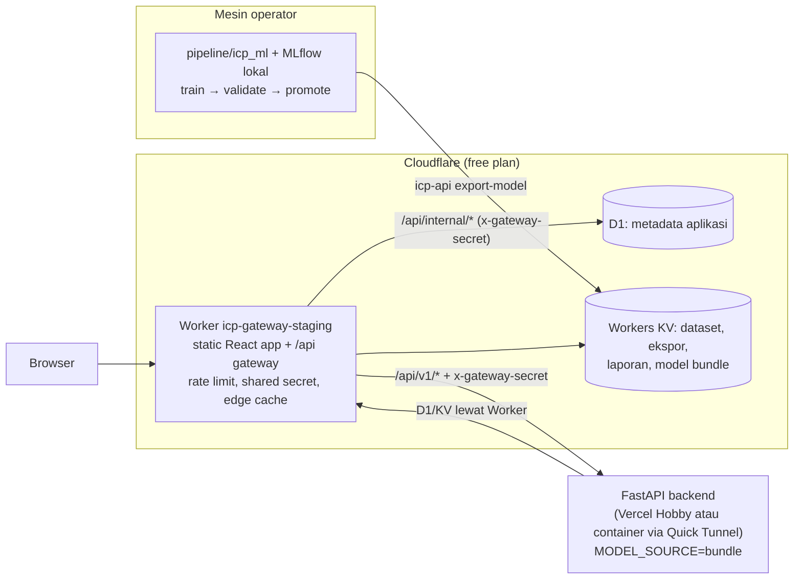

# Panduan Interview & Presentasi Proyek Akhir — ICP Intelligence

Dokumen ini merangkum semua hal tentang proyek yang kemungkinan ditanyakan saat interview dan
presentasi proyek akhir. Isinya diambil dari **source code di working tree** dan dari data lokal
(`var/metadata.db`, `var/mlflow/mlflow.db`, dibaca read-only) per **29 Oktober 2026**. Rujukan
`file:baris` disertakan supaya setiap klaim bisa ditunjukkan langsung di kode.

> **Baca dulu: tiga catatan kejujuran**
>
> 1. **Banyak pekerjaan belum di-commit.** Commit terakhir adalah `09d672c` (19 Okt 2026), yang sama
>    dengan `origin/main` di GitHub (`ReynoBenedict/MLops-ICP_prediction`). Di working tree ada sekitar
>    121 file diubah, 73 dihapus, dan 132 file baru yang belum di-commit. Contohnya engine insight
>    (`backend/icp_api/insights/`), billing, mode serverless/Vercel, design system, dan banyak tes.
>    **Kalau penguji membuka GitHub, sebagian besar isi dokumen ini belum terlihat di sana.**
>    Sebaiknya commit dan push dulu sebelum presentasi.
> 2. **Jumlah tes di dokumen ini hasil hitungan `grep`, bukan hasil menjalankan tes.** Hasil run
>    terakhir yang tercatat ada di README (27 Okt 2026). Untuk dokumen ini saya tidak menjalankan
>    test suite.
> 3. **Status deployment live tidak saya verifikasi.** Yang saya tulis adalah konfigurasi di kode dan
>    pernyataan di dokumen. README menyebut staging terakhir diperbarui 17 Okt 2026, dengan backend
>    lewat Quick Tunnel. Konfigurasi terbaru (`apps/gateway/wrangler.jsonc:64`) sudah mengarah ke
>    Vercel (`https://icp-api-staging.vercel.app`). `docs/DEPLOYMENT.md` (28 Okt) menyebut deploy
>    Vercel "disiapkan dan diverifikasi lokal" dan gateway belum di-redeploy.

---

## Daftar isi

1. [Ringkasan proyek (pitch)](#1-ringkasan-proyek-pitch)
2. [Latar belakang, masalah, tujuan](#2-latar-belakang-masalah-tujuan)
3. [Perjalanan proyek: tugas LK-02 sampai platform Oktober 2026](#3-perjalanan-proyek)
4. [Arsitektur sistem](#4-arsitektur-sistem)
5. [Tech stack dan versi](#5-tech-stack-dan-versi)
6. [Data: sumber, ingestion, rekonsiliasi, versioning](#6-data)
7. [Formulasi masalah forecasting](#7-formulasi-masalah-forecasting)
8. [Feature engineering](#8-feature-engineering)
9. [Metode/model kandidat](#9-metodemodel-kandidat)
10. [Evaluasi: rolling-origin backtest](#10-evaluasi-rolling-origin-backtest)
11. [Hasil model (angka nyata dari MLflow)](#11-hasil-model)
12. [Seleksi, registrasi, promosi, rollback](#12-seleksi-registrasi-promosi-rollback)
13. [Interval prediksi dan coverage](#13-interval-prediksi-dan-coverage)
14. [Drift detection (PSI)](#14-drift-detection-psi)
15. [MLflow, skops, dan model bundle](#15-mlflow-skops-dan-model-bundle)
16. [Alur satu request forecast end-to-end](#16-alur-satu-request-forecast-end-to-end)
17. [Backend (FastAPI)](#17-backend-fastapi)
18. [Akses, paket, dan keamanan](#18-akses-paket-dan-keamanan)
19. [Engine insight](#19-engine-insight)
20. [Frontend (React)](#20-frontend-react)
21. [Gateway (Cloudflare Worker)](#21-gateway-cloudflare-worker)
22. [Deployment dan hosting Rp0](#22-deployment-dan-hosting-rp0)
23. [CI/CD dan Continuous Training](#23-cicd-dan-continuous-training)
24. [Monitoring dan observability](#24-monitoring-dan-observability)
25. [Testing](#25-testing)
26. [Keterbatasan dan roadmap](#26-keterbatasan-dan-roadmap)
27. [Cheat sheet angka penting](#27-cheat-sheet-angka-penting)
28. [Bank pertanyaan interview + jawaban](#28-bank-pertanyaan-interview--jawaban)
29. [Pertanyaan jebakan: jawab dengan jujur](#29-pertanyaan-jebakan-jawab-dengan-jujur)
30. [Saran alur presentasi dan demo](#30-saran-alur-presentasi-dan-demo)
31. [Peta file penting](#31-peta-file-penting)
32. [Ketidaksesuaian dokumen vs kode yang diketahui](#32-ketidaksesuaian-dokumen-vs-kode-yang-diketahui)

---

## 1. Ringkasan proyek (pitch)

**Versi 30 detik.**
ICP Intelligence adalah aplikasi web untuk menganalisis dan memproyeksikan **Indonesian Crude Price
(ICP)**, yaitu harga minyak mentah resmi bulanan yang ditetapkan Kementerian ESDM. Sistem ini
membangun ulang seri ICP resmi langsung dari dokumen ESDM (Kepmen dan pengumuman), lengkap dengan bukti
per bulan. Seri itu digabung dengan Brent, Dubai, WTI, dan kurs JISDOR. Hasilnya disajikan sebagai
ringkasan pasar, proyeksi 1–6 bulan dengan rentang ketidakpastian, simulasi skenario, insight berbasis
aturan, dan laporan. Pipeline MLOps-nya mencakup versioning data, rolling-origin backtest, MLflow
tracking dan registry, promotion gate, drift (PSI), CI, dan model bundle untuk serving tanpa server
MLflow.

**Versi 2 menit (alur cerita).**
1. **Masalah.** ICP bulan *t* baru diumumkan awal bulan *t+1*. Nilainya tersebar di PDF Kepmen,
   sebagian berupa hasil scan, dan di berita. Tidak ada seri data yang bersih.
2. **Data.** Decree ESDM diambil, dibaca lewat text layer atau OCR, lalu dicocokkan dengan
   pengumuman. Bulan diberi status `verified`, `single_source`, atau `conflict`. Hasilnya 93 bulan
   (2019-01 sampai 2026-09) tanpa celah.
3. **Model.** Ada 11 metode kandidat, mulai dari persistence dan aturan benchmark + spread sampai
   ridge dan gradient boosting. Semuanya diuji dengan rolling-origin backtest di dua situasi input.
   Yang menang adalah aturan sederhana **Brent + rata-rata selisih 6 bulan** (`spread_brent_6m`). MAE
   1 bulannya 0,84 USD/bbl saat benchmark bulan itu sudah diketahui.
4. **Kejujuran.** Untuk bulan yang benar-benar di masa depan tanpa skenario, **tidak ada metode yang
   mengalahkan "ulangi bulan lalu"**. Karena itu aplikasi menampilkan proyeksi masa depan sebagai
   *kondisional terhadap asumsi benchmark*.
5. **Produk.** Ada situs publik, workspace pelanggan dengan multi-tenant, paket, dan role, serta
   konsol operator. Ketiganya ditegakkan di server, bukan hanya di UI.
6. **Ops.** Hosting dirancang Rp0: Cloudflare Worker + D1 + KV, dengan backend di Vercel Hobby atau
   container lewat Quick Tunnel. Training tetap di mesin operator, lalu model diekspor sebagai bundle.

---

## 2. Latar belakang, masalah, tujuan

Sumber: `README.md:1-19`, docstring `pipeline/icp_ml/sources/esdm_icp.py:1-21`.

- **Apa itu ICP.** Harga rata-rata bulanan minyak mentah Indonesia (USD/barel) yang ditetapkan lewat
  Keputusan Menteri ESDM. ICP dipakai dalam APBN, bagi hasil migas, dan perencanaan energi.
- **Masalah 1: tidak ada seri resmi yang bersih.** Nilai ada di PDF decree. Decree 2019–2021 berupa
  scan sehingga perlu OCR. Klausul operatifnya ("Harga rata-rata Minyak Mentah Indonesia untuk bulan
  … ditetapkan sebesar US$ …") biasanya ada di halaman 3–4 (`esdm_icp.py:252-258`).
- **Masalah 2: jeda publikasi.** Bulan yang sudah lewat belum punya ICP resmi. Ada juga kebutuhan
  memproyeksikan bulan ke depan.
- **Masalah 3: penyajian yang jujur.** Ketidakpastian dan asumsi harus terlihat oleh analis.
- **Tujuan proyek** (tiga butir di `README.md:13-17`):
  1. Membangun ulang seri resmi yang dapat dipercaya, dengan bukti per bulan.
  2. Mengestimasi bulan yang sudah berakhir tetapi belum dipublikasi, dan memproyeksikan bulan depan
     di bawah asumsi benchmark yang eksplisit.
  3. Menyajikan hasilnya ke analis energi, keuangan, dan perencanaan, dengan ketidakpastian dan asumsi
     yang terlihat.
- **Bahasa UI.** Bahasa Indonesia secara default, dengan toggle ke Inggris.

---

## 3. Perjalanan proyek

### 3.1 Tahap tugas kuliah (LK-02 sampai LK-12)

Sumber: `docs/archive/course-milestones-README.md` (README kuliah yang diarsipkan), kode di
`legacy/`, dan riwayat Git.

| Tahap | Isi | Bukti di repo |
|---|---|---|
| LK-02 | Struktur proyek, ingestion PDF ICP, EDA | `notebooks/01_eda.ipynb`, `notebooks/icp_exploration.ipynb` |
| LK-05 | **DVC**: dataset v1 (2019) lalu v2 (+2020), dibandingkan dengan `dvc diff` | `.dvc/`, `data/raw.dvc`, `data/processed.dvc` |
| LK-06 | **MLflow** tracking: LinearRegression dan RandomForest n=10/50/100. Menurut README arsip RF n=50 terbaik (RMSE 7,14, MAE 6,90; fitur hanya `lag_1`) | `legacy/pipeline-v1/src/training/train.py` (split kronologis 80/20, `:92-96`) |
| LK-07 | **Model Registry**: `ICP_Price_Model`, stage None → Staging → Production, inferensi lewat `models:/ICP_Price_Model/Production` | `legacy/pipeline-v1/src/training/infer.py`, `register_model.py` |
| LK-09 | **Docker Compose**: Streamlit + MLflow server + PostgreSQL | `legacy/pipeline-v1/docker-compose.yaml`; commit `866b1bf` |
| LK-10 | **FastAPI serving** (`/health`, `/predict`, `/docs`) dan **horizontal scaling** `docker compose up -d --scale model-api=3` | `legacy/serving/serving/app.py`, `legacy/evidence/scaling-proof.txt` (container `model-api-3`); commit `997a97a` |
| LK-11 | **Observability**: Prometheus + Grafana, `prometheus_fastapi_instrumentator`, histogram kustom `icp_prediction_value_usd` | `legacy/serving/serving/app.py:20-33`, `legacy/evidence/monitoring-scripts/`; commit `7cf34fd` |
| LK-12 | **Continuous Training**: GitHub Actions dengan trigger manual (alasan: `performance_degradation` / `data_drift`) dan jadwal. Ambang RMSE ≥ 10 dan PSI > 0,20; promosi jika RMSE kandidat < RMSE produksi | `legacy/ci/continuous-training.yml`, `legacy/pipeline-v1/simulate_drift_trigger.py`, `legacy/pipeline-v1/audit_and_promote.py`, `legacy/evidence/ct_trigger_event.json`; commit `567c5ef` |

Detail versi lama yang sering ditanyakan:
- **Model produksi lama.** `legacy/evidence/model_registry.yaml` mencatat produksi v7 =
  LinearRegression (RMSE 3,6164, MAE 1,9155; fitur `lag_1, lag_3, lag_6, rolling_mean_3, wti_price,
  wti_lag_1, wti_rolling_mean_3`). `legacy/evidence/metrics.json` berisi angka yang sama.
- **Drift lama disimulasikan.** `simulate_drift_trigger.py:110` membangkitkan PSI acak
  `rng.uniform(0.22, 0.45)`. Bukti event-nya `psi_simulated: 0.3092`.
- **Promosi lama** hanya membandingkan RMSE dan memakai MLflow *stages* yang sudah deprecated
  (`audit_and_promote.py`, `transition_model_version_stage`).
- **Jadwal CT lama.** File workflow lama memakai `cron: "0 17 28-31 * *"`
  (`legacy/ci/continuous-training.yml`). README arsip menyebut `0 0 * * 0` (mingguan). Yang benar
  sesuai file adalah yang pertama.

### 3.2 Refactor monorepo (commit `c3ec55b`)

Semua kode lama dipindahkan ke `legacy/`, yang tidak di-build dan tidak dites (`legacy/README.md`).
Penggantinya adalah `pipeline/icp_ml` (ML), `backend/icp_api` (FastAPI), `apps/web` (React),
`apps/gateway` (Cloudflare Worker), dan `packages/contracts` (OpenAPI).

**Cacat versi lama yang diperbaiki** (`docs/MIGRATION.md:25-76`; poin 1, 5, dan 6 saya cek langsung
di kode legacy):

| # | Cacat lama | Sekarang |
|---|---|---|
| 1 | Lag dihitung dengan `shift()` per baris (`legacy/pipeline-v1/src/data_processing/prepare_data.py:109-114`). Karena dataset bolong 8 bulan, `lag_1` bisa berarti "bulan tersedia sebelumnya", bukan bulan kalender sebelumnya | Lag dihitung di kalender bulanan penuh dan baris yang tidak lengkap dibuang (`pipeline/icp_ml/features.py:10, 108-117`) |
| 2 | Inferensi memakai WTI bulan N sebagai `wti_price` bulan N+1 | WTI bulan target dipakai jika sudah teramati. Jika belum, nilainya asumsi berlabel atau skenario |
| 3 | WTI bulan berjalan yang belum lengkap ikut dirata-rata | Bulan parsial dibuang lewat aturan kelengkapan (`sources/base.py:280-320`) |
| 4 | Ingestion lama menginterpolasi harga yang gagal di-parse, lalu menyimpannya seolah observasi | Bulan yang gagal di-parse dibuang dan dilaporkan; tidak ada interpolasi |
| 5 | `data_loader` mengembalikan data dummy kalau CSV hilang (`legacy/.../data_loader.py:17, 55-56`) | Gagal secara eksplisit (`503 DATASET_UNAVAILABLE` / `DATASET_INVALID`) |
| 6 | PSI acak | PSI dihitung dari distribusi fitur sungguhan (`pipeline/icp_ml/drift.py`) |
| 7 | CT melatih ke MLflow SQLite sementara di runner, sehingga hasilnya tidak pernah sampai ke serving | CT memanggil job API backend; promosi divalidasi di server |
| 8 | Promosi via stage, hanya cek RMSE | Alias `production` + rangkaian gate + riwayat + rollback |
| 9 | Kredensial `admin/admin` hard-coded; Streamlit CORS/XSRF dimatikan; error membocorkan teks exception | Secret dari environment, envelope error yang aman |
| 10 | Ingestion menimpa `dataset.csv` | Versi dataset immutable dan perubahan diaudit |

### 3.3 Oktober 2026: data resmi, metodologi baru, produk bisnis

Ringkasan dari `docs/MIGRATION.md:85-117` dan kode:
1. ICP resmi diambil dari dokumen ESDM dan direkonsiliasi (`sources/esdm_icp.py`, `esdm_backfill.py`).
2. Dataset baru: `brent`, `dubai`, `usd_idr`, `usd_idr_eom`.
3. Metodologi forecasting baru: metode bernama, rolling-origin backtest, dua mode input, interval
   empiris, dan model card.
4. Semantik forecast: origin, issue date, jenis titik (estimasi vs proyeksi).
5. Akun dan produk: organisasi, user, sesi, API key, paket, skenario, alert, laporan.
6. Frontend baru dengan Bahasa Indonesia sebagai bahasa utama, ditambah konsol operator.
7. Tahap berikutnya (lihat `docs/PRODUCT_TRANSFORMATION_2026-10.md`): kebijakan akses v4, engine
   insight, perbaikan keamanan v6 dan v7 (throttle, kuota, ekspor, permintaan penghapusan,
   idempotency), design system, performa, aksesibilitas, mode serverless/Vercel.

---

## 4. Arsitektur sistem

### 4.1 Diagram (mode staging/hosted)



### 4.2 Dua jalur utama

- **Serving path.** Browser hanya berbicara dengan Worker. Worker melayani build React dan meneruskan
  `/api/v1/*` ke backend dengan header `x-gateway-secret` (`apps/gateway/src/index.ts:708`). Backend
  menolak request yang tidak lewat gateway (`backend/icp_api/middleware.py:120-135`) dan tidak
  menyimpan state sendiri. Metadata ada di D1 dan objek di KV; keduanya diakses lewat route internal
  Worker. Prediksi dihitung dari **model bundle** hasil ekspor, jadi tidak ada server MLflow online.
- **Training path.** Training, validasi, dan promosi berjalan di mesin operator dengan MLflow lokal.
  Versi yang dipromosikan diekspor dengan `icp-api export-model` (`backend/icp_api/cli.py:256-288`).
  Backend mode bundle menolak training dan promosi dengan `409 OPERATION_UNAVAILABLE`.

### 4.3 Mode lokal

Kode yang sama berjalan di **SQLite** (`var/metadata.db`), object store filesystem (`var/objects`),
dan **MLflow SQLite** (`var/mlflow/mlflow.db`). Pemilihan backend dilakukan lewat variabel
environment (`backend/icp_api/settings.py`):

| Variabel | Pilihan | Default |
|---|---|---|
| `METADATA_BACKEND` | `sqlite`, `d1` (REST API), `d1_gateway` (lewat Worker) | `sqlite` |
| `OBJECT_STORE_BACKEND` | `local`, `s3` (S3/R2), `gateway` (KV lewat Worker) | `local` |
| `MODEL_SOURCE` | `mlflow`, `bundle` | `mlflow` |

### 4.4 Struktur repo

```
apps/web/            React SPA (pages, components, i18n, styles, public assets)
apps/gateway/        Cloudflare Worker: static assets, /api proxy, data plane D1/KV internal
backend/icp_api/     FastAPI: routers, services, storage, security, insights, billing, CLI
backend/tests/       38 file tes backend
pipeline/icp_ml/     sumber data + parser, fitur, metode, backtest, training, registry, bundle, drift
pipeline/configs/    training.yaml
pipeline/tests/      10 file tes pipeline
packages/contracts/  openapi.json + tipe TypeScript hasil generate
infra/               migrasi D1, Dockerfile, monitoring, render (dokumentasi), vercel
data/                CSV ICP asli (DVC), pointer DVC, seed CSV benchmark dan kurs
scripts/             setup, dev, smoke, contracts-check, secret-scan, landing-guard, deploy helper
legacy/              aplikasi Streamlit lama dan bukti tugas kuliah (referensi saja)
notebooks/           EDA (LK-02)
docs/                dokumentasi
```

---

## 5. Tech stack dan versi

Versi diambil dari `apps/web/package.json`, `package.json`, `apps/gateway/package.json`,
`pyproject.toml`, dan `requirements/constraints.txt`.

| Lapisan | Teknologi (versi pin) |
|---|---|
| Frontend | React 19.3.0, react-router-dom 7.18.4 (`createBrowserRouter`), Recharts 3.10.1 (hanya di workspace), lucide-react 1.49.0, Vite 8.3.1, TypeScript 5.9.3; font IBM Plex Sans/Serif self-hosted |
| Tes frontend | Vitest 5.0.3, Testing Library (react 16.3.3), jsdom 26.1.0 |
| Gateway | Cloudflare Workers, wrangler 4.150.0, Workers Rate Limiting, D1, KV, Cron Trigger |
| Backend | Python 3.10–3.12, FastAPI 0.143.2, Pydantic 2.14.1, Uvicorn 0.54.0, httpx 0.28.1, prometheus-client |
| Laporan | ReportLab 4.5.1 (PDF), openpyxl 3.1.5 (XLSX) |
| Data engineering | pandas 2.3.3, numpy 2.2.6, requests 2.34.2, PyMuPDF 1.27.2.3, pytesseract 0.3.13 (Tesseract OCR), BeautifulSoup + lxml, DVC |
| ML | scikit-learn 1.7.2, scipy 1.15.3 (NNLS), skops 0.16.0 (serialisasi model), MLflow 3.17.2 |
| Penyimpanan | SQLite (lokal), Cloudflare D1 + KV (staging); adapter S3/R2 dan Postgres untuk MLflow tersedia tetapi tidak dipakai deployment saat ini |
| Kontrak API | OpenAPI 3.1 (`packages/contracts/openapi.json`), openapi-typescript 7.13.0 |
| Kualitas | pytest, ruff, mypy, ESLint 10, bandit, pip-audit, npm audit, secret scanner buatan sendiri |
| Packaging | npm workspaces (Node ≥ 22.12), Docker (`python:3.11-slim-bookworm`, dipin dengan digest) |

---

## 6. Data

### 6.1 Dataset dan sumbernya

Definisi ada di `pipeline/icp_ml/schema.py:51-143` (`DATASET_SPECS`).

| Dataset | Isi | Sumber | Lisensi/catatan |
|---|---|---|---|
| `icp` | ICP resmi bulanan, USD/bbl | ESDM (Ditjen Migas): arsip Kepmen + pengumuman berita | Informasi publik |
| `wti` | Rata-rata bulanan spot WTI Cushing | U.S. EIA RWTC (API v2) atau mirror `datasets/oil-prices` | Public domain |
| `brent` | Rata-rata bulanan spot Brent Eropa | U.S. EIA RBRTE atau mirror | Public domain |
| `dubai` | Dubai Fateh, rata-rata bulanan | World Bank Pink Sheet | CC BY 4.0 (wajib atribusi) |
| `usd_idr` | Rata-rata bulanan JISDOR | Bank Indonesia web service | Atribusi "Bank Indonesia" |
| `usd_idr_eom` | Fixing JISDOR terakhir di bulan itu | Bank Indonesia | idem |

Konektor: `pipeline/icp_ml/sources/{esdm_icp,esdm_backfill,oil_benchmarks,worldbank_cmo,bi_jisdor}.py`.
URL EIA dan mirror ada di `oil_benchmarks.py:35-40`, endpoint JISDOR di `bi_jisdor.py:34`, dan arsip
ESDM di `esdm_icp.py:40-42`.

### 6.2 State data lokal saat ini (dibaca dari `var/metadata.db`)

| Dataset | Versi aktif | Baris | Periode | Sumber |
|---|---|---|---|---|
| icp | v4 | 93 | 2019-01 – 2026-09 | `esdm_official` |
| wti | v3 | 489 | 1986-01 – 2026-09 | mirror EIA |
| brent | v1 | 444 | 1987-06 – 2026-09 | mirror EIA |
| dubai | v1 | 801 | 1960-01 – 2026-09 | World Bank |
| usd_idr | v1 | 159 | 2013-06 – 2026-09 | Bank Indonesia |
| usd_idr_eom | v1 | 159 | 2013-06 – 2026-09 | Bank Indonesia |

Status verifikasi 93 bulan ICP (`provenance_json.buckets` dataset ICP aktif):
- **verified: 86**
- **single_source_accepted: 6** (2023-05, 2023-06, 2023-07, 2024-07, 2024-08, 2024-11)
- **ocr_accepted: 1** (2020-05)
- conflict: 0, missing: 0

Contoh nilai: ICP Sept 2026 = **112,81**, Agt 2026 = **89,43**, Sept 2025 = 66,81 USD/bbl.

Dibanding CSV asli (`data/raw/dataset.csv`, 79 baris dari 2019-01 sampai 2026-03 dengan 8 bulan
bolong), seri hasil rekonsiliasi **mengisi 14 bulan**. README menyebut ada **4 nilai yang
dikoreksi**. Versi v4 sendiri mengganti 2023-07 dari 80,96 menjadi **75,06**.

### 6.3 Ingestion ICP dari ESDM

**Decree (Kepmen):**
1. Tabel arsip di `migas.esdm.go.id/post/harga-minyak-mentah` di-parse (`parse_archive_table`).
2. Teks PDF dibaca dengan PyMuPDF, maksimal 4 halaman (`esdm_icp.py:235-240`). Jika text layer
   panjangnya lebih dari 200 karakter dan memuat klausul operatif, hasilnya dipakai sebagai
   `text-layer`.
3. Jika tidak, dilakukan **OCR Tesseract** sampai 6 halaman dengan **5 pass** berurutan
   `(dpi, psm, binarize)`: (220,6,F), (300,6,F), (300,4,T), (260,3,F), (340,6,T) (`:243-303`).
4. Nilai diambil dari klausul operatif lewat regex `_DECREE_ANCHOR`. Nomor decree hanya diambil dari
   blok tempat decree menyebut dirinya sendiri, sehingga regulasi yang dikutip tidak ikut terbaca
   (`decree_own_number`, `:204-220`). Ini perbaikan dari bug parser yang dulu menangkap nomor regulasi
   formula 276.K yang dikutip.

**Pengumuman berita.** Halaman berita di-crawl. Parser membedakan "naik US$ X" (perubahan) dari
"menjadi US$ Y per barel" (level) (`esdm_icp.py:307-450`).

**HttpClient** (`sources/base.py:154-278`):
- Retry 4 kali dengan backoff 1,5 untuk status 429/5xx dan menghormati `Retry-After`.
- Jeda minimal per host (politeness).
- Cache disk berdasarkan `sha256(url)[:32]` dengan revalidasi kondisional.
- User-Agent dikenali sebagai ICP-Intelligence.

### 6.4 Aturan rekonsiliasi (`esdm_icp.py:476-551`)

Observasi dibagi dua jenis:
- **Strong:** `decree_text`, `decree_ocr`, `announcement`.
- **Weak:** `announcement_backref` (pengumuman bulan berikutnya yang menyebut nilai bulan lalu) dan
  `legacy_csv`.

Status per bulan ditentukan sebagai berikut:
- **verified:** ≥ 2 observasi setuju (minimal satu strong), *atau* ada decree text layer, *atau* satu
  strong dikuatkan oleh weak.
- **single_source:** hanya satu strong (OCR atau pengumuman) tanpa penguat, atau hanya weak.
- **conflict:** observasi strong saling berbeda lebih dari toleransi 0,005, sehingga nilainya `None`.
  Pengecualian *majority rule*: jika ≥ 2 sumber setuju dan tepat satu strong berbeda, nilai mayoritas
  dipakai dan perbedaannya dicatat sebagai *dissent*.
- **missing:** tidak ada observasi.

Weak observation bisa menguatkan, tetapi tidak pernah menciptakan konflik dan tidak pernah cukup
sendirian.

Di backend (`backend/icp_api/services/icp_official.py`), bulan yang diterima adalah `verified`,
`single_source` dari pengumuman, dan decree OCR-only yang punya nomor decree (disimpan sebagai
`machine_extracted`). Nilai lama yang berbeda dicatat sebagai evidence `rejected`; tidak ada yang
dihapus.

### 6.5 Validasi kualitas data (`pipeline/icp_ml/schema.py:236-363`)

**Error** (dataset ditolak, tidak bisa diaktifkan):
- `EMPTY`, `SCHEMA_MISSING_COLUMNS`, `INVALID_PERIOD`, `NULL_VALUES`, `DUPLICATE_PERIODS`
- `VALUE_OUT_OF_RANGE`: batas keras harga (0, 500] USD/bbl; kurs (1000, 100000]

**Warning:**
- `VALUE_UNUSUAL`: batas lunak harga 5–250; kurs 8000–25000
- `UNSORTED`, `MISSING_PERIODS`
- `LARGE_MOM_CHANGE`: perubahan bulanan > 40% untuk harga, > 15% untuk kurs; hanya bulan berurutan
  yang dibandingkan

### 6.6 Aturan bulan parsial (`sources/base.py:280-320`)

Data harian diagregasi ke bulanan. Sebuah bulan dianggap **lengkap** hanya jika:
- bulannya sudah berakhir (zona waktu Jakarta, WIB);
- hari bursa yang teramati ≥ 60% dari hari kerja; dan
- observasi terakhir ada di minggu terakhir bulan itu, atau sudah ≥ 7 hari sejak akhir bulan.

### 6.7 Versioning data

- **DVC** (sejak LK-05) melacak `data/raw` (82 file, sekitar 161 MB: PDF dan CSV) dan `data/processed`
  (`data/raw.dvc`, `data/processed.dvc`).
- **Di aplikasi**, setiap perubahan membuat versi dataset baru yang **immutable dan content-addressed**:
  key objek `datasets/{ds}/{sha256}.csv`, dan SHA-256 diverifikasi ulang saat dibaca
  (`backend/icp_api/services/datasets.py:1-11, 94-129`).
  - Import CSV operator adalah dry-run secara default. Perubahan yang mengubah atau menghapus
    observasi memerlukan `confirm_overwrite`; tanpa itu hasilnya `409`.
  - Aktivasi versi hanya boleh jika `quality.ok`.
- **Prinsip:** bulan yang hilang ditampilkan sebagai celah dan **tidak pernah diinterpolasi**; bulan
  parsial tidak pernah masuk dataset; nilai resmi, estimasi, dan proyeksi diberi label berbeda
  (`README.md:170-174`).

---

## 7. Formulasi masalah forecasting

Sumber: docstring `pipeline/icp_ml/features.py:1-15` dan `pipeline/icp_ml/forecasting.py:1-21`.

**Target.** ICP resmi bulan *t* (USD/bbl), yang dipublikasi awal bulan *t+1*.

**Istilah penting:**

| Istilah | Arti |
|---|---|
| Forecast origin | Bulan terakhir yang punya ICP resmi |
| Issue date | Tanggal forecast dibuat |
| `estimate_awaiting_publication` | Bulan sudah berakhir tetapi ICP belum terbit. Benchmark bulan itu sudah teramati, jadi ini *nowcast* |
| `future_forecast` | Bulan belum berakhir. Benchmark harus diasumsikan, dari skenario user atau "tahan nilai terakhir" |

Sumber setiap input benchmark selalu dicatat: `observed`, `scenario`, `assumed_hold_last`, atau
`unavailable`.

**Horizon** 1–6 bulan (`MAX_HORIZON = 6`, `forecasting.py:35`). Batas nilai skenario: benchmark
(0, 500] dan kurs (1000, 100000] (`:36-37`).

**Multi-step bersifat rekursif.** Lag ICP setelah origin diisi prediksi model sendiri, tidak pernah
nilai aktual (`backtest.py:128-129`).

---

## 8. Feature engineering

File: `pipeline/icp_ml/features.py`.

- **Panel bulanan** (`build_panel`) menyejajarkan semua seri di satu kalender `PeriodIndex`
  frekuensi bulanan. Seri yang tidak punya observasi diisi NaN.
- **17 fitur** (`FEATURE_COLUMNS`, `:30-48`):
  - benchmark bulan yang sama: `wti_price`, `brent_price`, `dubai_price`
  - lag ICP: `icp_lag_1`, `icp_lag_2`, `icp_lag_3`, dan `icp_mean_3` (rata-rata 3 bulan sebelumnya)
  - lag benchmark: `wti_lag_1`, `brent_lag_1`, `dubai_lag_1`
  - spread (ICP − benchmark) bulan lalu: `spread_{wti,brent,dubai}_lag_1`
  - rata-rata spread 3 bulan: `spread_{wti,brent,dubai}_mean_3`
  - kurs: `usd_idr`
- **Calendar-aware.** Lag dihitung dengan `shift` pada kalender lengkap, jadi bulan yang bolong
  menghasilkan NaN dan **tidak pernah dijembatani**. Baris hanya dipakai jika target dan semua fitur
  yang dibutuhkan metode itu ada (`build_feature_frame`, `:108-117`).
- **Training = inferensi.** `feature_row` (dipakai saat inferensi) dijamin sama dengan baris
  `build_feature_frame`. Hal ini dites di `pipeline/tests/test_features.py:31,39`, termasuk dengan
  data asli.
- **Setiap metode mendeklarasikan fitur yang dibutuhkannya.** Karena itu baris yang lengkap dihitung
  per metode.

---

## 9. Metode/model kandidat

File: `pipeline/icp_ml/methods.py:176-238` (`DEFAULT_METHODS`). Semua metode adalah estimator yang
kompatibel dengan sklearn, sehingga bisa diregistrasi dan dilayani lewat jalur yang sama.

| Nama | Family | Rumus/parameter |
|---|---|---|
| `naive_last` | naive | ICP(t) = ICP(t−1) (persistence, baseline wajib) |
| `spread_wti_all` | spread_rule | WTI(t) + rata-rata selisih seluruh riwayat (baseline lama) |
| `spread_wti_12m` | spread_rule | WTI(t) + rata-rata selisih 12 bulan |
| `spread_brent_12m` | spread_rule | Brent(t) + rata-rata selisih 12 bulan (produksi v4) |
| **`spread_brent_6m`** | spread_rule | **Brent(t) + rata-rata selisih 6 bulan (produksi v5)** |
| `spread_dubai_12m`, `spread_dubai_6m` | spread_rule | Dubai + selisih 12 atau 6 bulan |
| `blend_benchmarks` | blend | w1·Brent + w2·Dubai + w3·WTI + c, least squares bobot non-negatif (`scipy.optimize.nnls` pada data yang di-demean) |
| `ridge_benchmarks` | ridge | α=3, fitur: brent, dubai, wti, icp_lag_1, spread_brent_lag_1 (StandardScaler) |
| `ridge_full` | ridge | α=10, semua 17 fitur |
| `gbm_benchmarks` | gradient_boosting | GradientBoostingRegressor n=200, depth 2, lr 0,05; fitur seperti ridge_benchmarks |

Family yang didukung config tetapi tidak ada di default: `linear` dan `random_forest`
(`config.py:17-25`). Config bisa mencampur nama default dengan spesifikasi inline
(`training.yaml:10-15`).

**Model produksi v5 dalam satu kalimat:** ICP bulan t ≈ Brent rata-rata bulan t + rata-rata (ICP −
Brent) dari 6 bulan terakhir. Spread hasil fitting untuk v5 adalah **−1,2633** (metrik
`fitted_spread`).

---

## 10. Evaluasi: rolling-origin backtest

File: `pipeline/icp_ml/backtest.py`. Config: `pipeline/configs/training.yaml`.

**Prosedur:**
- **Origin.** Setiap bulan ICP resmi yang punya ≥ 24 baris training (`min_train_rows: 24`).
- **Refit di setiap origin.** Untuk setiap origin *L*, model di-fit ulang pada data ≤ L, lalu diminta
  memprediksi L+1 sampai L+6 (`horizons: [1..6]`).

**Dua mode input:**

| Mode | Isi benchmark bulan target | Relevan untuk |
|---|---|---|
| `observed` | Nilai realisasi | Estimasi bulan yang sudah lewat tetapi ICP-nya belum terbit |
| `hold_last` | Benchmark **dan kurs** setelah L ditahan di nilai terakhir yang diketahui saat L | Bulan masa depan tanpa skenario |

**Anti look-ahead.** Setiap bulan dari L+1 sampai target diisi berurutan, ICP setelah origin dikosongkan,
dan lag diisi prediksi rekursif (`forecast_path`, `:66-145`).
`pipeline/tests/test_backtest_leakage.py` mengganggu ICP, benchmark, dan kurs setelah origin, lalu
mensyaratkan prediksi tetap identik.

**Metrik per (metode, mode, horizon)** (`summarize`, `:201-235`):
- MAE, RMSE, bias (mean error), sMAPE
- **MASE**: dibagi MAE naive satu langkah in-sample di setiap origin; hanya bulan berurutan yang dihitung
- **directional accuracy**: arah prediksi vs ICP(L)
- kuantil error q05, q10, q90, q95

**Perbandingan adil.** Leaderboard memakai `common_subset`, yaitu hanya pasangan (mode, origin,
horizon) yang dihasilkan **semua** metode (`:238-246`). Metode yang butuh riwayat lebih panjang jadi
tidak dibandingkan di jendela yang lebih mudah.

**Skor seleksi.** MAE rata-rata horizon 1–3 di mode `observed` (`training.yaml:29-32`). Metrik yang
diizinkan: mae, rmse, mase, smape (`config.py:113-114`).

**Kenapa bukan train/test split biasa?** Versi lama memakai split kronologis 80/20 tunggal. Rolling
origin menguji model di **banyak titik waktu** (69 origin untuk v5) dan per horizon. Ini lebih
representatif untuk data bulanan yang pendek dan penuh perubahan rezim. Fungsi
`chronological_split` masih ada (`features.py:141-148`) tetapi tidak dipakai untuk seleksi.

---

## 11. Hasil model

Angka di bagian ini **dibaca langsung dari MLflow lokal** (`var/mlflow/mlflow.db` dan artefak run
parent `f8785e7391954a3c867257b39b66f101`). Training v5: job `local-2026-10-17-official`, data ICP
2019-01 sampai 2026-09, **69 origin (2020-12 sampai 2026-08)**.

### 11.1 MAE semua metode pada kasus bersama (common subset; n = 66 di h1)

Mode **observed** (benchmark bulan target diketahui):

| Metode | h1 | h2 | h3 | h4 | h5 | h6 |
|---|---|---|---|---|---|---|
| naive_last | 6,09 | 9,06 | 10,66 | 11,72 | 12,41 | 13,40 |
| spread_wti_all | 2,00 | 2,01 | 2,01 | 1,98 | 1,98 | 1,97 |
| spread_wti_12m | 1,76 | 1,83 | 1,86 | 1,88 | 1,98 | 2,05 |
| **spread_brent_6m** | **0,85** | **0,94** | **1,00** | **1,02** | **1,04** | **1,07** |
| spread_brent_12m | 0,87 | 0,94 | 1,00 | 1,07 | 1,15 | 1,22 |
| spread_dubai_6m | 1,92 | 2,11 | 2,26 | 2,47 | 2,75 | 2,99 |
| spread_dubai_12m | 2,26 | 2,47 | 2,64 | 2,83 | 3,04 | 3,23 |
| blend_benchmarks | 1,09 | 1,19 | 1,24 | 1,27 | 1,30 | 1,33 |
| ridge_benchmarks | 1,51 | 2,22 | 2,47 | 2,67 | 2,93 | 3,11 |
| ridge_full | 2,92 | 3,94 | 4,49 | 4,54 | 4,35 | 4,83 |
| gbm_benchmarks | 2,35 | 3,09 | 3,66 | 4,63 | 5,18 | 5,73 |

Mode **hold_last** (masa depan tanpa skenario):

| Metode | h1 | h3 | h6 |
|---|---|---|---|
| naive_last | 6,09 | 10,66 | 13,40 |
| spread_brent_6m | 6,12 | 10,60 | 13,54 |
| blend_benchmarks | 6,10 | 10,59 | 13,46 |
| ridge_benchmarks | 6,09 | 10,22 | 13,84 |
| gbm_benchmarks | 6,16 | 10,64 | 13,23 |
| spread_wti_all | 6,17 | 10,25 | 13,44 |

**Leaderboard skor seleksi** (MAE rata-rata h1–h3, observed, common subset), dari
`evaluation/leaderboard.json`:

| Peringkat | Metode | Skor |
|---|---|---|
| 1 | spread_brent_6m | **0,929** |
| 2 | spread_brent_12m | 0,936 |
| 3 | blend_benchmarks | 1,174 |
| 4 | spread_wti_12m | 1,817 |
| 5 | spread_wti_all | 2,005 |
| 6 | ridge_benchmarks | 2,069 |
| 7 | spread_dubai_6m | 2,095 |
| 8 | spread_dubai_12m | 2,456 |
| 9 | gbm_benchmarks | 3,031 |
| 10 | ridge_full | 3,781 |
| 11 | naive_last | 8,605 |

Origin yang dilewati karena riwayat kurang: naive_last, ridge_benchmarks, dan gbm_benchmarks
melewatkan 2020-12; ridge_full melewatkan 2020-12 sampai 2021-02.

### 11.2 Metrik v5 pada kasusnya sendiri (69 origin)

| Metrik | observed | hold_last |
|---|---|---|
| MAE h1 | **0,838** (n=69) | **6,107** (n=69) |
| MAE h2 / h3 | 0,924 / 0,983 | 9,094 / 10,594 |
| MAE h4 / h5 / h6 | 0,996 / 1,015 / 1,044 | 11,81 / 12,62 / 13,70 |
| RMSE h1 | 1,053 | 8,494 |
| Bias h1 | −0,047 | – |
| sMAPE h1 | 1,03 % | – |
| MASE h1 | 0,154 | – |
| Akurasi arah h1 | 95,6 % | 52,9 % |

### 11.3 Cara membaca hasil (poin presentasi)

- **Saat benchmark bulan target sudah diketahui**, aturan Brent + spread 6 bulan menjelaskan ICP
  dengan error sekitar **0,84 USD/bbl**, dibanding 6,09 untuk persistence. Gradient boosting 2–5×
  lebih buruk dan makin buruk seiring horizon.
- **Untuk bulan masa depan tanpa pandangan benchmark, tidak ada metode yang mengalahkan
  persistence** (semua sekitar 6,1 di h1). Karena itu proyeksi masa depan disajikan sebagai
  *kondisional terhadap skenario benchmark*.
- **Kenapa ada angka 6,06 dan 6,09?**
  - **6,09 (6,0938)** adalah naive pada **66 kasus yang sama untuk semua metode**. Angka ini adalah
    metrik registry `baseline_naive_last_mae`.
  - **6,06 (6,0567)** adalah naive pada **69 kasus milik v5 sendiri**. Backend menghitungnya ulang
    dari prediksi backtest v5 yang tersimpan (`icp_ml.evaluation.baseline_by_step`,
    `pipeline/icp_ml/evaluation.py:43-54`).
  - Keduanya benar asal tidak dicampur. Halaman publik menampilkan 0,84 / 6,11 vs 6,06
    (`apps/web/src/pages/LandingPage.tsx:27-38`, konstanta hard-coded).
- **Batas generalisasi.** Riwayatnya pendek (data bulanan sejak 2019) dan didominasi perubahan rezim
  (2020, 2022, 2026). Angka ini menggambarkan periode tersebut, bukan akurasi umum.

### 11.4 Riwayat versi di registry lokal

| Versi | Metode | Catatan |
|---|---|---|
| v1–v3 | gradient_boosting (skema WTI-only lama) | holdout MAE 2,47, RMSE 3,97 (naive RMSE 10,31); train 2019-07..2024-04, test 2024-05..2026-03 |
| v4 | spread_brent_12m | metodologi rolling-origin pertama; skor 1,334, h1 MAE 1,149 |
| **v5** | **spread_brent_6m** | **alias `production`**; skor 0,929, h1 MAE 0,838, fit 2019-01..2026-09 (93 baris) |

Promosi tercatat di tabel `model_promotions`: 5 promosi pada 16 Okt 2026, semuanya tanpa `force`.
Promosi terakhir v4 → v5 beralasan "retrained with rolling-origin methodology and official benchmark
panel (local)".

---

## 12. Seleksi, registrasi, promosi, rollback

### 12.1 Seleksi (`pipeline/icp_ml/training.py:162-172`)

Pemenang adalah skor terkecil di leaderboard. Jika pemenangnya metode ML, metode **berbasis aturan**
yang skornya dalam **2%** dari pemenang diutamakan (`RULE_PREFERENCE_PCT = 2.0`, `:56`). Prinsipnya:
model tidak dipilih hanya karena lebih kompleks.

Training juga menolak berjalan jika jumlah baris lengkap ICP + WTI/Brent/Dubai kurang dari 30
(`min_feature_rows`, `training.py:142-149`).

### 12.2 Registrasi

Hanya pemenang yang diregistrasi ke model `ICP_Price_Model`. Version tag-nya memuat method spec, fit
period, skor, h1 MAE, baseline naive, git commit, SHA-256 config, dan versi serta SHA-256 dataset
(`training.py:479-503`).

**Registrasi tidak memindahkan alias produksi.** Promosi adalah langkah terpisah.

### 12.3 Gate promosi (`pipeline/icp_ml/registry.py:210-318`)

| Check | Lulus jika | Bisa di-`force`? |
|---|---|---|
| `version_exists`, `version_ready` | Versi ada dan status READY | Tidak |
| `has_method_spec` | Versi punya method spec (versi sebelum redesign ditolak) | Tidak |
| `model_loads`, `signature_matches_features` | Model bisa dimuat; signature = `FEATURE_COLUMNS` | Tidak |
| `smoke_prediction` | Prediksi pada baris uji berhingga dan > 0 | Tidak |
| `has_backtest_metrics` | Skor backtest tersedia | Ya |
| `beats_naive_baseline` | h1 MAE observed < naive | Ya |
| `hold_last_not_worse_than_naive` | h1 MAE hold_last ≤ naive × 1,10 | Ya |
| `not_worse_than_production` | Skor ≤ skor produksi × 1,05 | Ya |
| `not_already_production` | Versi belum jadi produksi | Ya |

Daftar check yang tidak bisa di-force diambil dari `backend/icp_api/services/models.py:429-436`.
`force=true` wajib disertai alasan ≥ 5 karakter dan hanya melewati gate metrik.

### 12.4 Alias, riwayat, rollback

- Produksi ditandai dengan **alias registry `production`**. MLflow *stages* sudah deprecated dan
  tidak dipakai (`registry.py:1-6`).
- Riwayat promosi (aktor, alasan, laporan validasi) disimpan di tabel `model_promotions`.
- **Rollback** hanya ke `from_version` dari promosi terakhir, dan hanya jika versi itu masih bisa
  dimuat (`services/models.py:470-505`).
- Job training dengan `auto_promote` memanggil `auto_promote_if_valid`, yang hanya mempromosikan
  jika semua gate lulus.

---

## 13. Interval prediksi dan coverage

- **Interval empiris, bukan parametrik.** Interval dibentuk dari kuantil error backtest per mode dan
  horizon, dengan level 50/80/95% (`backtest.py:259-275`). Disimpan sebagai
  `evaluation/intervals.json`.
- **Basis interval per titik** (`forecasting.py:174-180`):
  - `observed` jika semua input yang dipakai model bersumber `observed` atau `scenario`;
  - selain itu `hold_last`.
- **Coverage out-of-sample** (`split_coverage`, `backtest.py:278-314`):
  - Interval di-fit pada 60% origin pertama, lalu dicek pada 40% sisanya.
  - Sejak audit v7 ada **embargo**: kasus fit hanya dipakai jika bulan targetnya tidak melewati
    origin uji pertama.
  - v5 dilatih 16–17 Okt, sebelum embargo diterapkan. Backend menghitung ulang versi embargo saat
    dibaca (`evaluation.embargoed_coverage`).
- **Coverage 80% v5** (metrik yang dicatat saat training):

  | Mode | h1 | h2 | h3 | h4 | h5 | h6 |
  |---|---|---|---|---|---|---|
  | observed | 0,964 | 1,00 | 1,00 | 1,00 | 1,00 | 1,00 |
  | hold_last | 0,857 | 0,815 | **0,654** | 0,760 | 0,875 | 0,870 |

  Di mode hold_last, band h3 *under-cover*. Artinya rentang proyeksi masa depan meremehkan risiko
  pada periode volatil.
- **Peringatan otomatis.** Level yang coverage-nya jauh di bawah nominal, atau sampel < 20, memicu
  `coverage_warning`. Disclosure selalu menyebut `calibrated: false` (`backend/icp_api/services/explain.py:177-232`).
  Kata "calibrated" dan "guaranteed" sengaja tidak dipakai.

---

## 14. Drift detection (PSI)

File: `pipeline/icp_ml/drift.py`. Endpoint: `GET /api/v1/models/drift?recent_months=3..36` (operator).

**Rumus PSI:** Σ (cur% − ref%) · ln(cur% / ref%).
- Bin dibentuk dari kuantil data referensi (default 5 bin); tepi bin terluar diubah jadi ±∞.
- **Laplace smoothing 0,5** per bin, karena jendela bulanan kecil. Tanpa smoothing, satu bin kosong
  bisa mendominasi skor.

**Ambang:**

| PSI | Status |
|---|---|
| < 0,10 | stable |
| 0,10 – 0,20 | moderate |
| ≥ 0,20 | significant |

**Jendela disjoint:**
- *Current* = `recent_months` baris terakhir (default 12).
- *Reference* = baris sebelumnya yang ≤ akhir periode fit model.
- Syarat minimum: current ≥ 3 baris dan reference ≥ 10 baris.

Laporan menyebut jumlah sampel, rata-rata tiap jendela, dan catatan apakah baris current sudah
termasuk data fit. Jika sudah, yang diukur adalah perubahan kondisi, bukan drift pasca-deploy.

**Bedanya dengan LK-12.** Dulu PSI acak dan bisa memicu retraining. Sekarang PSI nyata, tetapi
**bersifat informasional**: workflow CT hanya menampilkannya dan tidak memakainya sebagai gate
(lihat [§23](#23-cicd-dan-continuous-training)).

---

## 15. MLflow, skops, dan model bundle

### 15.1 Struktur run MLflow (`pipeline/icp_ml/training.py:1-14, 261-504`)

Experiment `icp-price-forecasting`; model `ICP_Price_Model`; seed 42. MLflow lokal saat ini berisi
42 run.

**Parent run `training-<job id>`** mencatat:
- `config/training.yaml` beserta SHA-256-nya, versi/SHA dataset, dan git commit;
- `evaluation/backtest_metrics.csv`, `backtest_metrics_common.csv`, `backtest_predictions.csv`;
- `leaderboard.json` dan metrik naive.

**Satu nested run per metode** mencatat:
- params dan metrik per horizon/mode (`bt_<mode>_h<n>_<metrik>`) serta coverage;
- prediksi backtest milik metode itu;
- `intervals.json`, `interval_coverage.json`, `model_card.md`;
- model sklearn yang di-fit ke semua baris lengkap;
- untuk spread rule: `fitted_spread`; untuk blend: bobotnya.

**Tag** penting: `icp.run_kind` (parent/candidate), `icp.method_spec`, `icp.benchmarks_used`,
`icp.fit_period`, `icp.selection`.

`MLFLOW_RECORD_ENV_VARS_IN_MODEL_LOGGING=false` di-set supaya nama variabel rahasia tidak ikut
tercatat (`training.py:270-272`).

**Model card** (`model_card`, `:175-258`) berisi:
- tujuan penggunaan dan pembedaan dua situasi (observed vs masa depan);
- tabel error per horizon untuk kedua mode, berdampingan dengan naive;
- interval dan coverage, data training;
- keterbatasan.

### 15.2 skops, bukan pickle (`pipeline/icp_ml/serialization.py`)

Model diserialisasi dengan **skops** (`serialization_format="skops"`), yang tidak menjalankan kode
arbitrer saat load, berbeda dengan pickle.

Tipe yang dipercaya dibatasi oleh **allow-list** `SKOPS_ALLOWED_TYPES`: `sklearn.tree._tree.Tree`,
`icp_ml.methods.NaiveLast`, `SpreadRule`, dan `BenchmarkBlend`. Model yang berisi tipe lain ditolak.
Allow-list yang sama menjaga training dan bundle.

### 15.3 Model bundle (`pipeline/icp_ml/bundle.py`)

`icp-api export-model` menyalin satu versi dari MLflow ke object store:

```
models/production.json                  pointer versi produksi
models/bundles/index.json
models/bundles/<v>/meta.json            info versi + skops_trusted_types
models/bundles/<v>/model.skops          byte skops yang sama dengan di MLflow
models/bundles/<v>/{intervals.json, interval_coverage.json, model_card.md,
                    backtest_metrics.csv, backtest_predictions.csv}
```

- `BundleRegistry` menyediakan subset antarmuka registry untuk inferensi tanpa meng-import MLflow.
- **Prediksi identik** dengan mode MLflow; hal ini dites di `pipeline/tests/test_bundle.py` dan
  `backend/tests/test_api.py::test_bundle_mode_*`.
- Di mode bundle, validate/promote/rollback/train ditolak dengan `409 OPERATION_UNAVAILABLE`.

**Alasannya:** server MLflow online butuh database dan artifact store persisten, yang di hosting
gratis tidak tersedia. Pengaturan deploy mewajibkan MLflow tracking berbasis DB persisten dan
artefak `s3://` jika `MODEL_SOURCE=mlflow` (`settings.py:230-270`).

---

## 16. Alur satu request forecast end-to-end

Contoh: member menekan "Jalankan" di halaman Proyeksi dengan horizon 3 dan skenario Brent.

1. **Frontend** mengirim `POST /api/v1/forecasts` ke origin yang sama, dengan `Authorization: Bearer
   icp_sess_…` dan timeout 60 detik (`apps/web/src/api/client.ts:23-42`).
2. **Worker:**
   - mengecek rate limit (forecast 20/menit per IP dan per kredensial; `apps/gateway/src/index.ts:126-154`)
     dan batas body;
   - meneruskan request ke `BACKEND_URL` dengan `x-gateway-secret` dan `x-icp-client-ip`.
3. **Middleware backend** (`backend/icp_api/middleware.py`):
   - memvalidasi gateway secret, membuat request id, mengecek batas body;
   - memasang timeout request (default 30 detik) dan header keamanan.
4. **Security:**
   - me-resolve principal dari token sesi (hash SHA-256 dicocokkan di tabel `sessions`);
   - mengecek role (skenario butuh `analyst` + fitur paket `scenarios`);
   - mengecek horizon ≤ batas paket (`check_horizon` → `403 PLAN_LIMIT`);
   - menerapkan rate limit backend (bucket `forecast`).
5. **Idempotency (opsional).** Header `Idempotency-Key` berlaku 24 jam. Kunci sama dengan body
   berbeda menghasilkan `409 IDEMPOTENCY_KEY_REUSED`.
6. **Service forecast** (`services/forecasts.py:74-163`):
   - mengambil panel dataset aktif; origin = bulan ICP resmi terakhir;
   - memuat model produksi (MLflow alias atau bundle);
   - memanggil `icp_ml.forecasting.make_forecast(...)`.
7. **Hasil per bulan:** jenis titik (estimasi/proyeksi), prediksi, interval 50/80/95, sumber setiap
   input, flag input yang diabaikan model, dan ekuivalen rupiah (prediksi × kurs, dengan sumber
   kurs berlabel).
8. **Penyimpanan:** baris `forecast_runs` ditulis (termasuk jika gagal), bersama ekspor CSV immutable,
   `usage_events`, dan metrik Prometheus.
9. **Saat dibaca** (`services/explain.py`), hasil diperkaya dengan disclosure evaluasi per titik
   (periode backtest, n, baseline naive pada kasus yang sama, coverage), nilai resmi jika ESDM sudah
   menerbitkan, dan pemotongan sesuai paket.

---

## 17. Backend (FastAPI)

### 17.1 Perakitan aplikasi

- **Factory dan lifespan.** `create_app()` ada di `backend/icp_api/main.py:45-144`. Saat startup
  lifespan menjalankan migrasi dan seed lokal, `JobManager`, dan warm-up model di background thread
  (load dingin sekitar 6–10 detik).
- **Router:** `health`, `data`, `forecasts`, `models`, `jobs`, `accounts`, `product`, `billing`,
  ditambah `/metrics`. Totalnya sekitar 104 route.
- **OpenAPI:** 89 path, 102 operasi (52 GET, 50 POST), 144 schema. Dokumen `/docs` hanya dibuka jika
  bukan production (`EXPOSE_API_DOCS`).
- **Hanya GET dan POST.** Operasi seperti delete dan revoke dimodelkan sebagai sub-resource POST,
  misalnya `/alerts/rules/{id}/delete` dan `/org/api-keys/{id}/revoke`.
- **Envelope error seragam:** `{"error": {"code", "message", "request_id", "details"}}`
  (`errors.py`). Validasi gagal menjadi `422 VALIDATION_ERROR` dengan `details.issues`. Teks
  exception tidak pernah dikirim ke klien.
- **Logging JSON terstruktur** di staging dan production, dengan request id dari contextvar
  (`logging_setup.py`).
- **CLI `icp-api`** (`cli.py`): `serve` (selalu 1 worker), `migrate`, `seed`, `bootstrap`,
  `export-openapi`, `ingest {fx|benchmarks|icp}`, `export-model`, `backup`, `restore-check`,
  `clone-state`, `audit-prune`, `backfill-evidence`, `verify-provenance`, `backfill-dissent`,
  `repair-decree-references`, `billing-reconcile`, `new-token`.

### 17.2 Kelompok endpoint (ringkas)

| Kelompok | Contoh path | Siapa |
|---|---|---|
| Health | `/health/live`, `/health/ready`, `/api/v1/system/status` | publik; detail status hanya operator |
| Auth | `/auth/register`, `/auth/login`, `/auth/logout`, `/auth/whoami`, `/auth/password`, `/auth/sessions` | publik/member |
| Data | `/data/summary`, `/data/history`, `/data/verification`, `/data/evidence`, `/datasets/active` | member (riwayat dipotong sesuai paket) |
| Data ops | `/datasets/versions`, `/datasets/{ds}/imports`, `/datasets/versions/{id}/activate` | operator |
| Forecast | `POST /forecasts`, `/forecasts/latest`, `/forecasts/{id}`, `/forecasts/{id}/export.csv` | member |
| Model | `/models`, `/models/versions/{v}` (member); `/models/compare`, `/models/drift`, `.../validate`, `.../promote`, `/models/rollback` | operator untuk operasi tulis |
| Jobs & audit | `/jobs`, `/jobs/{id}/cancel`, `/jobs/{id}/retry`, `/audit` | operator |
| Produk | `/public/market-snapshot` (publik), `/insights`, `/scenarios`, `/scenarios/compare`, `/alerts/*`, `/reports` | member + fitur paket |
| Organisasi | `/org`, `/org/members`, `/org/api-keys`, `/org/plan-requests`, `/org/export`, `/org/deletion-requests` | member (owner/admin untuk sebagian) |
| Admin tenant | `/admin/organizations`, `/admin/plan-requests`, `/admin/deletion-requests` | operator |
| Billing | `/billing/*` | **nonaktif** (`503 BILLING_DISABLED`) |

### 17.3 Penyimpanan

- **Repository pattern.** Service tidak menulis SQL mentah; semuanya lewat `ProductRepository` /
  `MetadataRepository`. **Setiap tulis adalah satu statement**, karena D1 tidak punya transaksi
  interaktif. Konkurensi dijaga dengan compare-and-set dan partial unique index.
- **Tiga executor SQL** (`storage/sql.py`):
  - SQLite (WAL, busy_timeout 10 detik, foreign_keys ON);
  - D1 REST API;
  - D1 lewat Worker.
- **Retry policy:**
  - baca di-retry pada 429/5xx/koneksi;
  - tulis hanya di-retry pada 429/koneksi;
  - tulis yang mendapat 5xx atau timeout **tidak diulang**, karena mungkin sudah diterapkan.
- **Object store** (`storage/objects.py`): lokal (`os.link` atomik), S3/R2 (`IfNoneMatch="*"`), atau
  KV lewat Worker. Semuanya write-once, dengan validasi key (`..` dan `//` ditolak).
- **Migrasi.** 8 file di `infra/cloudflare/d1/migrations/`:

  | File | Isi |
  |---|---|
  | 0001_initial | dataset_versions, jobs, forecast_runs, model_promotions, audit_events |
  | 0002_sources_and_datasets | source_documents, source_evidence, ingestion_runs |
  | 0003_forecast_semantics | kolom origin, issue date, method, scenario, workflow |
  | 0004_accounts_and_product | organizations, users, sessions, api_keys, saved_scenarios, alerts, report_runs, usage_events |
  | 0005_plan_change_requests | |
  | 0006_deletion_requests | |
  | 0007_identity_lifecycle | |
  | 0008_billing_sandbox | |

  DB lokal ada di **schema 8** (23 tabel). Menurut docs, D1 staging masih di schema 4 dan perlu
  migrasi 0005–0008 sebelum deploy berikutnya.

### 17.4 Background jobs (`services/jobs.py`, `tasks.py`, `worker.py`)

- Status job: `queued → running → succeeded | failed | cancelled`.
- Maksimal satu job aktif per tipe, dijamin oleh partial unique index.
- **Setiap attempt jalan sebagai subprocess** (`python -m icp_api.worker`), sehingga training yang
  crash tidak menjatuhkan API. Exit code: 0 = sukses, 75 = transient (di-retry, backoff
  `min(60, 2^n)` detik), 1 = permanen.
- **Heartbeat** setiap 10 detik. Reaper menandai job gagal jika heartbeat basi lebih dari 120 detik.
- Tipe job:

  | Tipe | Timeout / attempt |
  |---|---|
  | `train` | 1800 s / 1 |
  | `ingest_benchmarks` | 300 s / 3 |
  | `ingest_fx` | 300 s / 3 |
  | `ingest_icp` | 3600 s / 2 |
  | `refresh_forecast` | 300 s / 2 |
  | `evaluate_alerts` | 300 s / 2 |

- Setelah data berubah, *post-hook* menerbitkan ulang **system forecast** (horizon 6) dan
  mengevaluasi alert.
- Di mode serverless (Vercel), job runner tidak ada, jadi endpoint job menjawab `503 JOBS_DISABLED`.

### 17.5 Fitur produk lain

- **Skenario.** Asumsi benchmark/kurs per bulan bisa disimpan dan dibandingkan (baseline + maksimal 4
  skenario). Input yang tidak dipakai metode diberi flag.
- **Alert.** Jenis rule: `icp_published`, `icp_change_pct` (default 5%), `benchmark_change_pct`
  (Brent 8%), `forecast_change` (3 USD), `data_stale`, `ingestion_failed`. Notifikasi in-app saja,
  dideduplikasi.
- **Laporan.** Jenis: `market_monthly`, `forecast`, `scenario_comparison`, `data_provenance`. Format
  PDF (ReportLab), XLSX (openpyxl), atau CSV, disimpan immutable. Mendukung `Idempotency-Key` dengan
  reservasi in-flight (`409 IDEMPOTENCY_IN_PROGRESS`).
- **Akun:**
  - registrasi organisasi (paket trial, pendaftar menjadi owner);
  - member dengan role viewer < analyst < admin < owner;
  - undangan dengan password sementara yang diserahkan manual (tidak ada e-mail);
  - API key dengan kuota bulanan;
  - permintaan ganti paket yang di-approve operator.
- **Privasi:**
  - ekspor data owner dalam ZIP (dibuat on-demand, tidak disimpan);
  - permintaan penghapusan akun/organisasi yang dieksekusi operator sebagai **anonimisasi**, bukan
    hard delete.
- **Public snapshot** (`services/public_snapshot.py`):
  - isinya ICP terbaru dan bulan sebelumnya, Brent, kurs, rupiah, 24 bulan terakhir, coverage
    verifikasi, dan dokumen bukti;
  - **tanpa nilai forecast**; hanya teaser (`available`, `issue_date`, horizon);
  - bulan yang `conflict` disembunyikan;
  - di-memo 60 detik untuk menghemat kuota baca D1.

---

## 18. Akses, paket, dan keamanan

### 18.1 Model akses v4 (ditegakkan di server)

| Peran | Akses |
|---|---|
| **Tamu** | `/plans`, `/public/market-snapshot`, login/register/whoami. Selain itu `401 AUTH_REQUIRED` + `WWW-Authenticate` |
| **Pelanggan** | Endpoint workspace di-scope ke organisasinya. **ID organisasi lain menghasilkan 404, bukan 403** (tidak membocorkan keberadaan). Horizon dan riwayat dipotong sesuai paket |
| **Operator** | Endpoint ops-only (status sistem, versi dataset, model, jobs, audit, tenant). **Ditolak (403)** di endpoint organisasi pelanggan; operator tidak bisa bertindak di dalam org pelanggan |

### 18.2 Paket (`backend/icp_api/entitlements.py:42-119`)

| | trial | starter | professional | enterprise |
|---|---|---|---|---|
| Kursi | 2 | 5 | 20 | 1000 |
| Horizon maksimal | 3 bulan | 6 | 6 | 6 |
| Skenario tersimpan | 2 | 10 | 100 | 1000 |
| Laporan Excel | ✗ | ✓ | ✓ | ✓ |
| Alert rule | 2 | 10 | 50 | 500 |
| Akses API / kuota per bulan | ✗ | ✗ | ✓ / 20.000 | ✓ / 500.000 |
| Riwayat harga | 3 tahun | tak terbatas | tak terbatas | tak terbatas |

Catatan:
- PDF, skenario, alert, dan insight tersedia di semua paket.
- **Tidak ada harga** yang didefinisikan, hanya catatan teks.
- Kode paket yang tidak dikenal jatuh ke `trial`.

### 18.3 Autentikasi

- **Sesi:**
  - token `icp_sess_` + `secrets.token_urlsafe(32)`; yang disimpan hanya SHA-256-nya;
  - kedaluwarsa absolut 30 hari dan idle timeout 168 jam (`services/accounts.py:30`);
  - `last_seen_at` diperbarui paling sering setiap 5 menit, untuk menghemat kuota tulis D1.
- **Password:**
  - **scrypt** dari stdlib dengan n=2^15, r=8, p=1, salt 16 byte, dklen 32 (sekitar 32 MiB per hash);
  - format berversi `scrypt$ln=15,r=8,p=1$salt$digest` sehingga bisa di-rehash nanti
    (`accounts.py:34-55`);
  - minimal 10 karakter;
  - setiap ganti password mencabut semua sesi.
- **Anti user enumeration.** E-mail yang tidak terdaftar tetap dicek terhadap hash dummy, jadi waktu
  respons sama. Reset password memberi jawaban yang sama.
- **Password sementara.** Format `Icp-…`, kedaluwarsa 72 jam. Selama belum diganti, hampir semua
  request menjawab `403 PASSWORD_CHANGE_REQUIRED`.
- **Token operator** (`ADMIN_API_TOKENS`) dibandingkan secara constant-time.
- **API key:**
  - format `icp_live_…`, disimpan sebagai SHA-256 dan ditampilkan sekali;
  - bertindak sebagai role analyst;
  - kuota bulanan atomik lewat satu INSERT kondisional, jadi request bersamaan tidak bisa melampaui
    kuota; jika habis, `429 QUOTA_EXCEEDED`.

### 18.4 Pembatasan dan proteksi

- **Throttle login:**
  - per (hash e-mail, IP): 5 gagal per 15 menit;
  - per akun lintas IP: 100;
  - e-mail yang tidak dikenal di-throttle dengan cara yang sama.
- **Rate limit dua lapis:**
  - edge (Worker): 300/menit untuk API umum, 20/menit untuk `POST /forecasts`;
  - backend: sliding window in-memory; bucket default 300, forecast 30, auth 10, admin 30/240.
- **Satu instance backend.** `API_INSTANCES != 1` ditolak saat startup, karena counter rate limit
  ada di memori proses.
- **Gateway secret** dibandingkan constant-time dan mendukung rotasi (`GATEWAY_ACCEPTED_SECRETS`).
  Header IP klien hanya dipercaya jika secret valid.
- **Header keamanan** (API): `nosniff`, `X-Frame-Options: DENY`, `Referrer-Policy: no-referrer`,
  CSP `default-src 'none'`, CORP same-origin, HSTS saat deploy, dan `Cache-Control: no-store`.
- **Keamanan laporan:**
  - semua nilai dinamis di-escape sebelum masuk markup ReportLab;
  - `harden_reportlab()` memblokir akses file, URL, dan UNC. Ini memperbaiki bug P0, karena string
    user dulu bisa memicu SSRF;
  - **CSV/formula injection** dinetralkan: sel yang diawali `= + - @` (termasuk varian Unicode
    setelah NFKC) diberi prefix `'` di XLSX dan CSV.
- **Tidak ada CSRF.** Autentikasi memakai bearer header, bukan cookie, dan CORS
  `allow_credentials=False`.
- **Validasi config saat startup.** Mode deploy menolak setup tidak aman: gateway secret < 32
  karakter, `METRICS_TOKEN` < 32 karakter, CORS `*`, SQLite sebagai metadata, dan `EMAIL_ENABLED=true`
  karena belum ada provider.
- **Supply chain dan secret:**
  - GitHub Actions dipin ke SHA commit;
  - `pip-audit`, `npm audit`, dan `bandit` (`--ignore-nosec`);
  - SBOM CycloneDX;
  - secret scanner buatan sendiri dengan 19 rule.

### 18.5 Risiko sisa yang diakui di kode/dokumen

- Style `'unsafe-inline'` di CSP halaman, dan tidak ada HSTS untuk aset statis di `*.workers.dev`.
- Header IP klien perlu dikonfirmasi di staging.
- Allow-list SQL di Worker berbasis regex, bukan parser SQL. Pemegang secret punya akses DML penuh
  ke D1 (inferensi agen dari kode).
- **Belum pernah ada audit keamanan formal atau penetration test** (`README.md:338-339`).

---

## 19. Engine insight

File: `backend/icp_api/insights/`, dokumen `docs/INSIGHT_ENGINE.md`.

- **Deterministik, berbasis aturan, tanpa LLM, tanpa klaim kausal.** `ENGINE_VERSION = "2026-10.2"`.
  Teks disusun dari template server dalam Bahasa Indonesia atau Inggris (`?lang=id|en`). Frontend
  hanya merender; kesimpulan bisnis tidak dibuat di klien.
- **Rule** (`rules.py`):

  | Rule | Mendeteksi |
  |---|---|
  | `icp_mom`, `icp_yoy` | Perubahan bulanan dan tahunan |
  | `icp_trend_run` | ≥ 3 gerakan searah berturut-turut |
  | `icp_extreme_move` | Gerakan terbesar dalam 24 bulan |
  | `spread_vs_history` | Spread ICP–benchmark di luar rentang 36 bulan |
  | `fx_context` | Konteks kurs |
  | `forecast_outlook` | Pandangan forecast beserta MAE backtest dan coverage |
  | `forecast_revision` | Revisi antar system forecast |
  | `data_freshness`, `benchmark_freshness` | Data terlambat |
  | `data_verification` | Bulan yang belum terkonfirmasi |
  | `model_evaluation` | Hold-last vs naive pada kasus yang sama |
  | `ingestion_failure` | Ingestion gagal (khusus operator) |

- **Kontrak evidence.** Setiap insight wajib membawa dataset dan versinya, jendela periode, input,
  output, kunci metode, dan angka berhingga. Insight yang tidak lengkap dibuang.
- **Konsistensi.** Rule arah (mom, extreme, trend) harus sepakat; kalau tidak, ketiganya dibuang.
  Pelanggan mendapat maksimal 8 insight, diurutkan berdasarkan tingkat kepentingan.

---

## 20. Frontend (React)

Sumber: laporan agen untuk `apps/web/`.

- **Router.** `createBrowserRouter`, dipilih supaya `useBlocker` bisa menahan navigasi saat form
  skenario belum disimpan (*leave guard*).
- **Rute:**

  | Kelompok | Rute |
  |---|---|
  | Publik | `/`, `/metodologi`, `/masuk`, `/daftar`, `/syarat`, `/privasi` |
  | Workspace | `/ringkasan`, `/harga`, `/proyeksi`, `/insight` (member + operator); `/skenario`, `/laporan`, `/pemberitahuan`, `/akun` (pelanggan saja) |
  | Operator | `/operasi`, `/operasi/data`, `/operasi/model`, `/operasi/pekerjaan`, `/operasi/audit`, `/operasi/organisasi` |

  Selain operator, `/operasi` menampilkan NotFound biasa supaya konsolnya tidak diiklankan.
  (`apps/web/src/App.tsx:328-346`)
- **Guard tidak berbohong:**
  - tamu diarahkan ke `/masuk?next=`, dan `next` hanya diterima jika path same-origin;
  - jika sesi tidak bisa dicek (timeout/5xx), muncul halaman "sesi belum terkonfirmasi" dengan tombol
    coba lagi, bukan redirect;
  - timeout tidak pernah dianggap logout;
  - **logout menunggu server**; jika server gagal, sesi dipertahankan dan user diberi tahu.
- **Penyimpanan token:**
  - token sesi di `localStorage["icp.sessionToken"]`;
  - token operator di `sessionStorage`, jadi hanya berlaku per tab;
  - setiap 401 memicu event `icp:auth-expired`, lalu whoami dicek ulang.
- **API client** (`apps/web/src/api/client.ts`):
  - hanya memanggil `/api/v1/...` di origin yang sama; tidak ada URL backend atau secret di bundle;
  - timeout per jenis request: whoami 8 detik, snapshot 10, compute 60, laporan 95 (sengaja di atas
    batas gateway 90 detik);
  - tipe TypeScript diambil dari kontrak OpenAPI.
- **i18n.** Setiap string adalah pasangan `[id, en]`, sehingga kedua bahasa tidak bisa
  "lupa-diterjemahkan". Kamus workspace dan ops di-load lazy. Ada tes yang memeriksa placeholder,
  jargon ML, dan key yang dipakai sebelum kamusnya dimuat.
- **Design system** (`docs/DESIGN_SYSTEM.md`, `styles/tokens.css`):
  - font IBM Plex;
  - warna navy `#123A5C`, teal `#0F6B73` (elemen interaktif), amber (brand);
  - warna seri yang lolos validator CVD: ICP `#1D6FB8`, Brent `#E8692F`, Dubai `#6250D6`, WTI
    `#8A5A0B`;
  - tema terang saja.
- **Chart.** Recharts hanya dipakai di workspace. Chart publik dibuat sebagai **SVG biasa** supaya
  bundle landing kecil.
- **Performa.** Entry bundle hanya berisi landing; shell, auth, dan workspace di-split ke chunk
  terpisah. `scripts/check-landing-bundle.mjs` menggagalkan build jika landing memuat Recharts. CI
  memasang budget **160.000 byte gzip**; landing terukur 152.366 B gzip pada 26 Okt menurut komentar
  skrip.
- **Aksesibilitas:**
  - skip link dan ring `:focus-visible`;
  - fokus dipindah ke h1 saat rute berganti;
  - modal dengan focus trap dan latar `inert`;
  - live region untuk toast;
  - setiap chart punya ringkasan `aria-describedby` dan tampilan tabel yang bisa diakses keyboard;
  - `prefers-reduced-motion` dan `forced-colors` didukung; ukuran huruf dalam rem.

---

## 21. Gateway (Cloudflare Worker)

File: `apps/gateway/src/index.ts`, `apps/gateway/wrangler.jsonc`.

- **Routing.** `/api/*` ditangani `handleApi`. Path lain dilayani dari aset statis `../web/dist`
  dengan fallback SPA. Request id diterima jika valid; jika tidak, dibuat `gw_<uuid>`.
- **Proxy `/api/v1/*`:**
  - hanya method GET/HEAD/POST/OPTIONS;
  - batas body 2 MB;
  - hanya header tertentu yang diteruskan (accept, content-type, authorization, if-none-match,
    idempotency-key);
  - `x-gateway-secret` ditambahkan dan menimpa apa pun yang dikirim klien;
  - timeout upstream 30 detik secara default (90 detik di staging), 8 detik untuk rute publik;
  - GET di-retry sekali hanya saat koneksi gagal;
  - redirect upstream menjadi `502 UPSTREAM_REDIRECT`;
  - halaman error non-JSON (misalnya 530 dari Cloudflare) diganti envelope JSON 502/504.
- **Rate limiting** memakai binding Workers Rate Limiting. Kuncinya IP, ditambah prefix SHA-256 dari
  kredensial (token itu sendiri tidak pernah dipakai sebagai kunci).
- **Data plane internal `/api/internal/*`** (backend ke Worker ke D1/KV):
  - autentikasi dengan secret ≥ 32 karakter, dibandingkan secara constant-time;
  - `d1/query` hanya menerima satu statement SELECT/INSERT/UPDATE/DELETE/WITH; ATTACH, PRAGMA, DDL,
    dan transaksi ditolak; maksimal 100 parameter;
  - `objects/<key>` untuk KV dengan validasi key, batas 25 MiB, dan TTL ekspor 180/365 hari.
- **Edge cache last-known-good (kontrak C2):**
  - jawaban anonim `GET /public/market-snapshot` dan `/plans` disalin ke KV;
  - jika backend mati, salinan itu dilayani dengan header `X-ICP-Cache: stale` dan `X-ICP-Cached-At`;
    frontend menampilkannya sebagai "salinan tersimpan";
  - penulisan KV dibatasi (paling sering tiap 5 menit, dan saat konten berubah) karena kuota KV gratis
    hanya 1.000 tulis per hari.
- **Cron** harian `17 22 * * *` (05:17 WIB), hanya di staging, untuk menyegarkan salinan publik.
  **Warm-on-visit:** navigasi browser sungguhan (bukan bot) memicu satu `GET /health/live` non-blocking
  untuk membangunkan backend serverless. Keep-warm berkala sengaja tidak ada, supaya kuota Vercel
  Hobby tidak terpakai.
- **Environment:**

  | | Worker | BACKEND_URL | D1/KV |
  |---|---|---|---|
  | Lokal | `icp-gateway-local` | `http://127.0.0.1:8000` | tidak di-bind |
  | Staging | `icp-gateway-staging` | `https://icp-api-staging.vercel.app` | D1 `icp-metadata-staging` dan KV |
  | Production | `icp-gateway` | placeholder Render | placeholder; deploy production ditolak sampai diisi |

---

## 22. Deployment dan hosting Rp0

- **Target:** Rp0 per bulan, tanpa kartu, tanpa risiko tagihan berbasis pemakaian
  (`docs/DEPLOYMENT.md`).
- **Komponen gratis yang dipakai:**
  - Cloudflare Workers Free (100 ribu request per hari);
  - D1 Free (5 juta baca dan 100 ribu tulis per hari);
  - KV Free (100 ribu baca dan 1.000 tulis per hari, 1 GB, 25 MiB per nilai);
  - Vercel Hobby (Python 3.12, region `sin1`, maxDuration 60 detik di `infra/vercel/vercel.json`).
- **Yang dievaluasi dan ditolak:**
  - Render Free: API menolak membuat service dengan **402 "Payment information is required"**
    (`infra/render/README.md`);
  - R2: butuh checkout subscription;
  - Hugging Face Spaces Docker: berbayar;
  - Replit, Koyeb, Fly, Railway: tidak gratis atau butuh kartu.
- **Riwayat topologi:**
  1. **17 Okt 2026.** Staging = Worker + D1/KV, dengan backend berupa container di laptop yang diekspos
     lewat **Cloudflare Quick Tunnel** (`scripts/staging-backend.mjs`). Saat backend online, smoke
     test lolos **11/11** dan uji fitur E2E **18/18** (`README.md:54-58`).
  2. **28 Okt 2026.** Backend dipindah ke **Vercel Hobby** (`scripts/vercel-backend.mjs`,
     `backend/icp_api/serverless.py`). Quick Tunnel menjadi fallback manual. Menurut docs, deploy
     Vercel disiapkan dan diverifikasi lokal; redeploy gateway belum.
- **Mode serverless:**
  - hanya direktori temp yang bisa ditulis;
  - tidak ada job runner;
  - ingestion dan training dijalankan dari mesin operator ke store gateway;
  - paket Python sekitar 356 MB terpasang di atas batas 225 MiB dalam fungsi, jadi sebagian dipasang
    ulang saat cold start. Mlflow, uvicorn, boto3, dan psycopg2 sengaja tidak disertakan.
- **Docker:**
  - `infra/docker/api.Dockerfile` adalah single-stage `python:3.11-slim-bookworm` yang dipin digest,
    dengan Tesseract, user non-root uid 10001, healthcheck `/health/live`, dan
    `CMD python -m icp_api.cli serve`;
  - `docker-compose.yml` berisi `api` (port 8000), serta `prometheus` dan `grafana` di profil
    `observability`; semua port di-bind ke 127.0.0.1.
- **Jalankan lokal:**

  ```bash
  npm install
  npm run setup    # venv, secret lokal, migrasi, seed, train + promote model pertama, contracts, build web
  npm run dev      # API :8000, web :5173
  npm run dev:edge # backend + build produksi di belakang Worker sungguhan (wrangler dev :8787)
  ```

- **Port lokal:** 8000 API, 5173 Vite, 8787 wrangler, 5000 MLflow UI, 9090 Prometheus, 3000 Grafana.

---

## 23. CI/CD dan Continuous Training

### 23.1 CI (`.github/workflows/ci.yml`)

Trigger: push dan pull request ke `main`. Permission `contents: read`, action dipin ke SHA. Workflow
ini **tidak melakukan deploy** dan tidak memegang kredensial cloud.

**Job `check`** (dengan `ICP_REQUIRE_DATA=1`, sehingga tes data gagal alih-alih di-skip):
1. Install Python dan Node.
2. `npm run lint` (ruff + ESLint).
3. `npm run typecheck` (mypy + tsc).
4. `contracts:check`: OpenAPI di-generate ulang lalu dibandingkan dengan yang di-commit; jika berbeda,
   gagal.
5. `npm test` (pytest + Vitest web + Vitest gateway).
6. `npm run build` (web + dry-run Worker).
7. Landing bundle guard (≤ 160.000 B gzip).
8. Guard lisensi aset.
9. Secret scan.

**Job `security`:**
- `pip-audit` pada constraints;
- `npm audit --omit=dev --audit-level=moderate`;
- `bandit -ll --ignore-nosec` pada `backend/icp_api` dan `pipeline/icp_ml`;
- secret scan;
- SBOM CycloneDX untuk Python dan npm.

### 23.2 Continuous Training (`.github/workflows/continuous-training.yml`)

- **Trigger: `workflow_dispatch` saja.** Jadwal bulanan dihapus pada 20 Okt 2026 (`:3-11`).
- **Langkah:**
  1. Panggil `GET /system/status` dan catat `model_source`.
  2. Jalankan job ingestion `ingest_benchmarks`, `ingest_fx`, dan `ingest_icp` lewat API backend, lalu
     poll statusnya.
  3. Tampilkan laporan drift (`max_psi`) **hanya sebagai informasi**.
  4. Training (`{"job_type":"train","params":{"auto_promote":true}}`) **hanya jika** input `train`
     bernilai true **dan** backend melaporkan `model_source=mlflow`.
- **Kondisi sekarang:** backend staging berjalan di mode **bundle**, sehingga CT otomatis tidak aktif.
  Retraining adalah prosedur lokal operator: job `train`, lalu validate dan promote, lalu
  `icp-api export-model`. Untuk backend serverless, endpoint job menjawab `503 JOBS_DISABLED`. Saya
  menyimpulkan langkah ingestion di workflow ini akan gagal terhadap backend Vercel; ini belum dicoba.
- **Kenapa tidak otomatis?** Hosting gratis tidak menyediakan backend always-on dengan MLflow
  persisten. Daripada CT yang tampak berjalan tetapi hasilnya tidak pernah sampai ke serving (masalah
  di LK-12), workflow ini menolak dengan jujur.

---

## 24. Monitoring dan observability

- **Metrik Prometheus** (`backend/icp_api/metrics.py`):
  - `icp_http_requests_total{method,route,status}`
  - `icp_http_request_duration_seconds{method,route}`
  - `icp_forecast_runs_total{status}`
  - `icp_prediction_value_usd` (histogram distribusi prediksi; pergeseran bisa mengindikasikan
    drift atau model decay)
  - `icp_jobs_total{job_type,status}`

  `/metrics` dilindungi `Bearer METRICS_TOKEN`, yang wajib ≥ 32 karakter saat deploy.
- **Grafana** (`infra/monitoring/grafana/dashboards/icp_dashboard.json`), dashboard "ICP Platform -
  API & pipeline" dengan 6 panel:
  1. request per detik per route;
  2. rasio 5xx;
  3. latensi p50/p95;
  4. forecast per jam per outcome;
  5. distribusi prediksi 24 jam;
  6. status job 24 jam.

  Prometheus scrape setiap 15 detik (`infra/monitoring/prometheus.yml`).
- **Health:**
  - `/health/live` untuk liveness;
  - `/health/ready` menjalankan check paralel dengan timeout 5 detik;
  - check kritis: `metadata_store` dan `object_store`;
  - check non-kritis: `schema_version`, registry/bundle, model produksi, dataset, job runner;
  - publik hanya melihat `status`.
- **Logging** JSON terstruktur dengan request id; satu baris log per request.
- **Keterbatasan:** di deployment gratis tidak ada alerting, SLA, atau uptime monitoring. Stack
  Prometheus/Grafana hanya untuk lokal lewat profil compose `observability`.
- **Riwayat:** LK-11 memakai `prometheus_fastapi_instrumentator` dan histogram yang sama di service
  `/predict` lama.

---

## 25. Testing

### 25.1 Jumlah tes (hitungan `grep`, 29 Okt 2026, tidak dijalankan)

| Area | File | Fungsi/kasus tes |
|---|---|---|
| Backend (`backend/tests`) | 38 | 344 `def test_` (ada 31 `parametrize`, jadi item runtime lebih banyak) |
| Pipeline (`pipeline/tests`) | 10 | 60 `def test_` |
| Web (`apps/web/src`) | 21 | sekitar 246 `it(`/`test(` |
| Gateway (`apps/gateway/test`) | 6 | sekitar 100 `it(`/`test(` |

**Hasil run terakhir yang tercatat di README (27 Okt 2026):**
- **1.227 item pytest, 254 tes web, 83 tes gateway lulus**;
- ruff, mypy, tsc, ESLint bersih; kontrak sinkron; build sukses; secret scan bersih.

Kode berubah setelah tanggal itu (misalnya tes Vercel/serverless), jadi jalankan `npm run check`
sebelum presentasi kalau ingin angka terbaru. Jumlah item pytest jauh lebih besar dari jumlah fungsi
karena tes ter-parametrize.

### 25.2 Tes yang paling layak disebut

- **Tanpa kebocoran masa depan:**
  - `pipeline/tests/test_backtest_leakage.py`: data setelah origin diganggu, prediksi harus identik;
  - `test_features.py::test_lags_never_bridge_calendar_gaps`;
  - `test_feature_row_matches_frame_on_real_data`.
- **Kesetaraan serving:** prediksi mode bundle = mode MLflow (`pipeline/tests/test_bundle.py`,
  `backend/tests/test_api.py::test_bundle_mode_*`).
- **Integrasi nyata:** `backend/tests/test_api.py` memakai storage, dataset, dan model yang
  **benar-benar dilatih** lewat job API. Config training dipercepat menjadi 4 metode dan horizon 1–3
  (`backend/tests/conftest.py:49-66`).
- **Kontrol akses:** `test_access_control.py` (tamu/pelanggan/operator, isolasi tenant, batas paket)
  dan `test_d_plan_matrix.py` (semua paket di semua jalur).
- **Keamanan:**
  - `test_security_api.py` (throttle, header, IDOR);
  - `test_report_safety.py` (SSRF markup PDF, formula injection);
  - `test_auth_abuse.py`;
  - `test_v7_security.py`.
- **Simulator:** `D1Simulator` (protokol D1 di atas SQLite asli) dan `GatewaySimulator` (meniru
  allow-list SQL Worker).
- **Frontend:** batas akses (`boundary.test.tsx`), alur login/logout (`flows.test.tsx`), boot saat
  backend tidak merespons (`auth.test.tsx`), dan aturan kamus i18n.
- **Tidak ada framework E2E browser di repo** (tidak ada Playwright/Cypress di `package.json`).
  Pengecekan browser dilakukan dengan skrip headless Chrome lokal di luar repo.

---

## 26. Keterbatasan dan roadmap

### 26.1 Keterbatasan (diakui di README dan kode)

**Model:**
- Proyeksi bulan depan tanpa skenario tidak lebih baik dari persistence.
- Interval tidak sadar volatilitas; coverage hold_last h3 hanya 0,65.

**Data:**
- Riwayat pendek (2019–2026, 93 titik bulanan).
- Satu bulan diterima dari OCR saja (2020-05) dan 6 bulan dari satu sumber.
- Nilai benchmark bukan *point-in-time vintage*.
- Tidak ada kurva forward/futures karena lisensi.

**Deployment:**
- Tidak ada host backend yang always-on dan persisten. Staging bergantung pada Vercel Hobby (cold
  start, kuota) atau laptop.
- Tidak ada alerting, SLA, atau load test.
- Kuota gratis berlaku (KV 1.000 tulis per hari).

**Produk:**
- Tidak ada integrasi pembayaran (billing hanya sandbox Midtrans yang nonaktif, dan order berstatus
  paid tidak mengubah paket).
- Tidak ada pengiriman e-mail; undangan dan reset diserahkan manual.
- Tidak ada MFA dan tidak ada transfer owner.
- Rate limit in-memory, sehingga backend harus satu instance.

**Proses:**
- Belum ada audit keamanan formal atau review hukum untuk halaman syarat dan privasi.
- CT otomatis tidak aktif.

### 26.2 Roadmap (`README.md:372-381`)

1. Deploy transformasi ke staging, lalu pindahkan backend ke host persisten.
2. Ukur dan kurangi round trip storage D1.
3. Uptime monitoring, alerting, dan retensi log.
4. MFA, kebijakan lockout, dan review eksternal.
5. Load testing.
6. E-mail, pembayaran, dan transfer owner.
7. Rentang prediksi yang sadar volatilitas untuk bulan masa depan.

---

## 27. Cheat sheet angka penting

| Hal | Angka |
|---|---|
| Seri ICP resmi | 2019-01 – 2026-09, **93 bulan**, tanpa celah |
| Status verifikasi | 86 verified, 6 single source, 1 OCR-only (2020-05), 0 conflict |
| ICP Sept 2026 | **US$ 112,81/bbl** (Agt 2026: 89,43) |
| CSV asli | 79 baris (2019-01..2026-03, bolong 8 bulan); +14 bulan setelah rekonsiliasi |
| Fitur | 17 kolom (`FEATURE_COLUMNS`) |
| Metode kandidat | 11 (`DEFAULT_METHODS`) |
| Backtest | rolling origin, ≥ 24 baris training, horizon 1–6, 2 mode; **69 origin (2020-12..2026-08)** untuk v5 |
| Seleksi | MAE rata-rata h1–h3 mode observed; aturan diutamakan jika dalam 2% |
| Model produksi | **v5 `spread_brent_6m`** = Brent(t) + rata-rata spread 6 bulan (spread −1,26) |
| Skor seleksi v5 | 0,929 (runner-up `spread_brent_12m` 0,936) |
| MAE h1 v5 | observed **0,84**, hold_last **6,11**; naive di kasus yang sama **6,06** |
| Naive pada common subset | 6,09 (n=66) |
| GBM (keluarga produksi lama) | observed h1 2,35; h6 5,73 |
| Coverage 80% | observed 0,96–1,00; hold_last 0,65–0,88 |
| Gate promosi | beat naive; hold_last ≤ naive + 10%; ≤ produksi + 5%; load/signature/smoke |
| PSI | < 0,10 stable; 0,10–0,20 moderate; ≥ 0,20 significant; smoothing 0,5; 5 bin |
| Horizon per paket | trial 3, lainnya 6 |
| Rate limit edge | 300/menit API, 20/menit forecast |
| Throttle login | 5 gagal per 15 menit per (e-mail, IP); 100 per akun |
| Password | scrypt n=2^15, r=8, p=1 |
| Sesi | 30 hari absolut, idle 168 jam |
| OpenAPI | 89 path, 102 operasi, 144 schema |
| Migrasi DB | 8 (schema 8 lokal) |
| Budget landing JS | 160.000 B gzip (terukur 152.366 B) |
| Tes (grep) | backend 344, pipeline 60, web ~246, gateway ~100 |
| Run terakhir tercatat | pytest 1.227 item, web 254, gateway 83 (27 Okt 2026) |
| E2E staging 17 Okt | smoke 11/11, fitur 18/18 |

---

## 28. Bank pertanyaan interview + jawaban

> Jawaban di bawah berbasis kode. Kalau ditanya detail, sebutkan file-nya.

### A. Umum dan motivasi

**Q: Jelaskan proyekmu dalam satu menit.**
Lihat [§1](#1-ringkasan-proyek-pitch). Intinya: seri ICP resmi dibangun ulang dari dokumen ESDM
dengan bukti per bulan; model sederhana dipilih lewat backtest yang adil; serving dibuat jujur
(estimasi vs proyeksi, sumber input berlabel, rentang empiris); semuanya dibungkus produk
multi-tenant dengan infrastruktur gratis.

**Q: Siapa penggunanya dan apa nilai bisnisnya?**
Analis di tim energi, keuangan, dan perencanaan (`README.md:16-17`). Nilainya:
- tahu ICP bulan yang sudah lewat sebelum ESDM mengumumkannya, dengan error sekitar US$0,84;
- bisa mensimulasikan skenario Brent atau kurs untuk bulan depan;
- punya seri resmi yang bisa diaudit.

**Q: Apa yang paling sulit?**
Datanya, bukan modelnya:
- decree hasil scan perlu OCR multi-pass;
- klausul operatif harus dibedakan dari angka lain di dokumen;
- nomor decree yang dikutip pernah salah terbaca sebagai nomor decree itu sendiri;
- pengumuman menulis "naik US$ X" (perubahan) dan "menjadi US$ Y" (level) dengan pola mirip;
- semua sumber harus direkonsiliasi tanpa mengarang nilai.

**Q: Apa beda versi tugas kuliah (LK) dengan versi sekarang?**
Lihat [§3](#3-perjalanan-proyek). Cacat lama yang diperbaiki: lag yang menjembatani bulan bolong,
data dummy, PSI acak, CT yang hasilnya tidak sampai ke serving, dan promosi hanya berdasarkan RMSE.

### B. Data

**Q: Dari mana datanya, dan bagaimana kamu tahu datanya benar?**
- ICP dari Kepmen ESDM dan pengumuman berita, benchmark dari EIA dan World Bank, kurs dari JISDOR
  Bank Indonesia.
- Kebenaran ICP dijaga lewat rekonsiliasi multi-sumber (verified/single_source/conflict).
  Dokumennya disimpan beserta SHA-256 sebagai bukti, dan status tiap bulan ditampilkan ke user lewat
  `/data/verification`.
- Benchmark dan kurs diberi label `provider_published`, tidak pernah "verified".

**Q: Bagaimana menangani missing value?**
Tidak diinterpolasi. Bulan yang hilang tetap jadi celah. Lag dihitung di kalender penuh sehingga
celah menghasilkan NaN, dan baris itu dibuang dari training metode yang butuh fitur tersebut
(`features.py:108-117`). Setelah rekonsiliasi, seri ICP tidak punya celah.

**Q: Kenapa tidak interpolasi?**
Karena interpolasi berarti mengarang angka resmi. Versi lama melakukannya dan nilai karangan itu
tersimpan sebagai observasi (cacat #4 di MIGRATION). Untuk harga resmi negara, lebih baik celahnya
terlihat.

**Q: Bagaimana kalau dua sumber berbeda?**
Statusnya `conflict` dan nilainya `None`, kecuali ≥ 2 sumber setuju dan tepat satu sumber kuat
berbeda; dalam kasus itu mayoritas dipakai dan yang berbeda dicatat sebagai *dissent*
(`esdm_icp.py:476-551`). Bulan `conflict` disembunyikan di snapshot publik.

**Q: Bagaimana versioning data?**
Dua lapis:
- DVC untuk file mentah (PDF dan CSV), sejak LK-05;
- di aplikasi, versi dataset immutable dan content-addressed (SHA-256), dengan diff antar versi,
  aktivasi eksplisit, dan konfirmasi untuk perubahan destruktif. Setiap forecast dan training
  mencatat versi dataset yang dipakai.

**Q: Bagaimana menangani bulan berjalan yang datanya belum lengkap?**
Agregasi harian ke bulanan menandai bulan lengkap hanya jika bulan sudah berakhir, cakupan hari bursa
≥ 60%, dan sudah settle (`sources/base.py:280-320`). Bulan parsial tidak masuk dataset.

### C. Model dan evaluasi

**Q: Model apa yang dipakai?**
`spread_brent_6m`: ICP(t) = Brent(t) + rata-rata (ICP − Brent) 6 bulan terakhir. Ini bukan model ML
kompleks. Model ini menang secara adil melawan 10 kandidat lain, termasuk ridge dan gradient
boosting.

**Q: Kenapa model sesederhana itu?**
Tiga alasan:
1. **Bukti.** Skornya 0,929, sementara GBM 3,031 dan ridge_full 3,781 pada kasus yang sama.
2. **Struktur domain.** ICP memang mengikuti harga benchmark internasional ditambah selisih yang
   bergeser pelan.
3. **Aturan seleksi** mengutamakan metode berbasis aturan jika selisihnya ≤ 2%.

Dengan 93 titik bulanan, model kompleks rawan overfit. Ini terlihat dari GBM yang makin buruk di
horizon panjang.

**Q: Kenapa tidak pakai LSTM / ARIMAX seperti rencana awal?**
README LK-02 merencanakan hybrid ARIMAX-LSTM. Rencana itu tidak diimplementasikan, dan tidak ada
LSTM/ARIMAX di kode. Alasan yang sudah ditulis sejak LK-06/LK-07 adalah data terlalu sedikit (dulu
sekitar 18 bulan) sehingga rawan overfit. Sekarang datanya 93 bulan dan hasil backtest menunjukkan
model aturan sederhana sudah mencapai error sekitar 0,84 ketika benchmark diketahui. Masalah
utamanya adalah ketidakpastian benchmark masa depan, bukan kurangnya kapasitas model. Framework
`MethodSpec` memungkinkan menambah family baru dan mengujinya di backtest yang sama jika suatu saat
diperlukan.

**Q: Bagaimana mencegah data leakage?**
- Lag dihitung as-of.
- Backtest me-refit model di setiap origin hanya dengan data ≤ origin.
- ICP setelah origin dikosongkan dan diisi prediksi rekursif.
- Mode `hold_last` juga menahan kurs.
- Ada tes yang mengganggu data masa depan dan mensyaratkan prediksi identik (`test_backtest_leakage.py`).
- Coverage interval memakai embargo.

**Q: Kenapa dua mode (observed vs hold_last)?**
Karena pertanyaan bisnisnya ada dua:
1. Berapa ICP bulan lalu yang belum diumumkan? Benchmark-nya sudah diketahui, jadi errornya kecil.
2. Berapa ICP bulan depan? Benchmark-nya belum diketahui.

Menggabungkan keduanya akan menutupi fakta bahwa proyeksi masa depan tidak lebih baik dari naive.

**Q: Metrik apa dan kenapa MAE?**
Yang dihitung: MAE, RMSE, bias, sMAPE, MASE, dan akurasi arah. Seleksi memakai MAE karena satuannya
USD/bbl sehingga mudah dipahami bisnis dan tidak terlalu didominasi outlier seperti RMSE. MASE
memberi perbandingan relatif terhadap naive; nilai v5 0,154 artinya error sekitar 15% dari error naive
1 langkah.

**Q: Apa itu common subset dan kenapa perlu?**
Hanya kasus (mode, origin, horizon) yang dihasilkan semua metode yang dibandingkan. Tanpa itu, metode
yang butuh riwayat lebih panjang dinilai di jendela berbeda, sehingga perbandingannya tidak adil.

**Q: Bagaimana menyampaikan ketidakpastian?**
Lewat interval empiris 50/80/95% dari error backtest per mode dan horizon. Coverage-nya dicek
out-of-sample dan diberi peringatan jika kurang. Kata "calibrated" sengaja tidak dipakai. Setiap
angka akurasi disertai periode, n, dan baseline naive pada kasus yang sama.

**Q: Hasil terbaikmu berapa?**
MAE 1 bulan 0,84 USD/bbl (observed, 69 kasus), dibanding 6,06 untuk naive pada kasus yang sama.
Akurasi arah 95,6%. Untuk masa depan tanpa skenario: 6,11 vs 6,06, artinya tidak lebih baik dari
naive, dan aplikasi mengatakan hal itu.

### D. MLOps

**Q: Jelaskan siklus hidup model di proyekmu.**
1. Data di-ingest ke versi dataset baru.
2. Job `train` menjalankan backtest semua metode, mencatat semuanya ke MLflow (parent + nested run,
   artefak, model card), lalu meregistrasi pemenang.
3. `validate` dijalankan dengan gate.
4. `promote` memindahkan alias `production` dan mencatat riwayat.
5. `export-model` membuat bundle di object store.
6. Backend memuat bundle dan system forecast diterbitkan ulang.
7. Drift dipantau dengan PSI.
8. Rollback ke versi sebelumnya bila perlu.

**Q: Kenapa alias, bukan stage?**
MLflow stages sudah deprecated. Alias `production` plus riwayat promosi di DB aplikasi memberi
audit trail (siapa, kapan, alasan, laporan validasi) dan rollback (`registry.py:1-6`).

**Q: Apa isi gate promosi?**
Lihat [§12.3](#123-gate-promosi-pipelineicp_mlregistrypy210-318). Gate keras (load, signature, smoke
prediction, method spec) tidak bisa di-force. Gate metrik bisa di-force dengan alasan tertulis.

**Q: Bagaimana reproducibility dijamin?**
- Config training (dengan SHA-256), git commit, versi dan SHA dataset, seed 42, serta pin
  `pip_requirements` (sklearn, pandas, numpy, skops, scipy) dicatat di setiap run.
- Dependensi dipin di `requirements/constraints.txt` dan `package-lock.json`.
- Docker image dipin dengan digest.

**Q: Kenapa skops?**
pickle bisa mengeksekusi kode saat load. skops tidak, dan proyek ini menambah allow-list tipe yang
eksplisit. Bundle memakai allow-list yang sama sehingga tidak bisa memuat tipe yang ditolak saat
training.

**Q: Kenapa model bundle, bukan server MLflow?**
Server MLflow butuh DB persisten dan artifact store, yang tidak tersedia di hosting gratis. Bundle
memuat byte skops yang sama, sehingga prediksinya identik (dites). Training dan promosi tetap
dijalankan di tempat MLflow berada.

**Q: Bagaimana drift dideteksi, dan apakah memicu retraining?**
PSI per fitur dengan Laplace smoothing dan jendela disjoint. Hasilnya informasional: tidak otomatis
memicu retraining, karena backend yang ter-deploy berjalan di mode bundle. Di LK-12 dulu PSI-nya acak;
sekarang nyata tetapi dipakai dengan jujur.

**Q: Ada CI/CD dan CT?**
- **CI:** lint, typecheck, contract drift check, semua tes, build, bundle budget, lisensi aset, secret
  scan, plus job keamanan (pip-audit, npm audit, bandit, SBOM).
- **CD:** tidak otomatis. Deploy dilakukan manual lewat skrip.
- **CT:** workflow manual yang memanggil job API backend dan hanya melatih jika backend memakai MLflow.

**Q: Bagaimana scaling?**
- LK-10 mendemokan horizontal scaling dengan `--scale model-api=3`.
- Versi sekarang **sengaja satu instance** (`API_INSTANCES=1` dipaksa), karena rate limit dan throttle
  disimpan in-memory; kuota API sudah atomik di DB.
- Skala di edge ditangani Cloudflare Worker.
- Untuk multi-instance, counter rate limit perlu dipindah ke store bersama. Ini ada di roadmap
  implisit dan belum dikerjakan.

**Q: Monitoring apa yang ada?**
Metrik Prometheus (request, latensi, forecast runs, distribusi prediksi, jobs), dashboard Grafana 6
panel, readiness check, dan log JSON. Belum ada alerting di deployment.

### E. Backend dan arsitektur

**Q: Kenapa ada gateway Worker di depan backend?**
- Browser tetap same-origin.
- URL backend dan secret tidak pernah dikirim ke klien.
- Rate limiting dilakukan di edge.
- Ada salinan publik last-known-good saat backend mati.
- Backend bisa mengakses D1/KV tanpa token API Cloudflare.

**Q: Bagaimana multi-tenancy?**
Setiap query di-scope dengan `org_id`. ID milik organisasi lain menghasilkan 404, bukan 403, supaya
keberadaan resource tidak bocor. Operator tidak bisa masuk ke organisasi pelanggan. Hal ini dites di
`test_access_control.py`.

**Q: Kenapa setiap tulis satu statement?**
D1 tidak punya transaksi interaktif. Konkurensi dijaga dengan compare-and-set, partial unique index
(misalnya satu job aktif per tipe dan satu permintaan pending per organisasi), dan INSERT kondisional
untuk kuota.

**Q: Bagaimana menangani request ganda (double submit)?**
Dengan header `Idempotency-Key` di `POST /forecasts` dan `POST /reports` (berlaku 24 jam). Body
berbeda dengan kunci sama menghasilkan 409. Laporan juga punya reservasi in-flight.

**Q: Bagaimana background job dibuat aman?**
Job berjalan sebagai subprocess, dengan heartbeat dan reaper. Worker yang kehilangan heartbeat
dimatikan. Retry hanya untuk error transient. Maksimal satu job aktif per tipe.

### F. Keamanan

**Q: Bagaimana password disimpan?**
scrypt (n=2^15, r=8, p=1) dengan salt 16 byte, format berversi untuk rehash, dan perbandingan
constant-time. E-mail tidak dikenal tetap dihash dummy supaya waktu respons tidak membocorkan
keberadaan akun.

**Q: Celah keamanan apa yang pernah ditemukan dan diperbaiki?**
- **P0:** string user masuk ke markup ReportLab dan bisa memicu SSRF atau akses file. Diperbaiki dengan
  escape semua nilai dan `harden_reportlab()`.
- **Formula injection** di CSV/XLSX: dinetralkan.
- **Bug parser nomor decree:** nomor regulasi yang dikutip sempat terbaca sebagai nomor decree.

Referensi: `docs/REMEDIATION_REPORT_2026-10.md`, `backend/tests/test_report_safety.py`.

**Q: Bagaimana mencegah brute force?**
Throttle login per (e-mail, IP) dan per akun, rate limit edge dan backend, dan audit kegagalan yang
diagregasi.

**Q: Sudah dipentest?**
Belum. Tidak ada audit formal (`README.md:338-339`). Yang ada adalah tes keamanan otomatis, bandit,
audit dependensi, dan threat model (`docs/THREAT_MODEL.md`).

### G. Frontend dan UX

**Q: Kenapa React + Vite, bukan Streamlit seperti dulu?**
Streamlit cocok untuk prototipe. Produk multi-tenant butuh routing, guard akses, i18n, aksesibilitas,
kontrol bundle, dan hosting statis di edge. Versi Streamlit juga mematikan CORS/XSRF (cacat #9).

**Q: Bagaimana memastikan UI tidak menyesatkan?**
- Label estimasi vs proyeksi.
- Label sumber input.
- Salinan "stale" diberi tanda.
- Tamu tidak pernah melihat nilai forecast.
- Logout tidak dipalsukan saat offline.
- 404 dibedakan dari "tidak terjangkau".
- Bulan conflict ditandai.
- Narasi insight berasal dari server.

### H. Deployment

**Q: Di mana aplikasinya di-host dan berapa biayanya?**
Targetnya Rp0. Komponennya Cloudflare Worker + D1 + KV (free) dan backend di Vercel Hobby, dengan
fallback container di laptop lewat Quick Tunnel. Render ditolak karena meminta kartu (402).
Detailnya di [§22](#22-deployment-dan-hosting-rp0). Status live-nya cek dulu sebelum presentasi.

**Q: Apa yang terjadi kalau backend mati?**
Landing tetap tampil dari aset statis. Snapshot publik dan daftar paket dilayani dari salinan KV
dengan label "stale". Fitur lain menampilkan pesan bahwa layanan data tidak tersedia.

---

## 29. Pertanyaan jebakan: jawab dengan jujur

| Pertanyaan | Jawaban jujur |
|---|---|
| "Modelmu bisa memprediksi harga bulan depan dengan akurat?" | Tidak tanpa asumsi benchmark. Untuk masa depan tanpa skenario, MAE v5 6,11 vs naive 6,06. Akurasi tinggi (0,84) hanya untuk bulan yang sudah lewat, ketika benchmark-nya sudah diketahui. |
| "Kenapa pakai ML kalau aturannya sederhana?" | Kontribusinya adalah **sistem MLOps** untuk membandingkan dan memilih metode secara adil, dan kesimpulan bahwa aturan sederhana menang. Pipeline yang sama bisa melayani model ML jika suatu saat menang. |
| "Interval 80%-mu benar 80%?" | Untuk observed sekitar 96–100% (konservatif). Untuk hold_last turun ke 65% di h3. Aplikasi menampilkan peringatan dan tidak menyebutnya calibrated. |
| "Sudah production?" | Belum. Ini proyek portofolio dengan staging. Verdict audit internal: "ready for staging verification" (`docs/audits/`). Tidak ada SLA, alerting, atau load test. |
| "CT-mu otomatis?" | Tidak. Workflow CT manual, dan training hanya jalan jika backend memakai MLflow. Backend staging memakai bundle, jadi retraining dilakukan lokal oleh operator. Jadwal otomatis sengaja dihapus. |
| "Drift memicu retraining?" | Tidak. PSI hanya informasi. Saat LK-12, PSI-nya simulasi acak; ini sudah diperbaiki menjadi PSI nyata. |
| "Billing dan e-mail jalan?" | Tidak. Billing adalah sandbox Midtrans yang nonaktif (`BILLING_ENABLED=false`), dan `EMAIL_ENABLED=true` ditolak saat startup. |
| "Berapa coverage tes?" | Tidak ada angka coverage yang dilaporkan. Yang ada jumlah tes dan hasil run terakhir. Jangan menyebut persen coverage. |
| "Semua ini ada di GitHub?" | Commit terakhir 19 Okt 2026. Banyak pekerjaan setelahnya belum di-commit; commit dan push sebelum presentasi. |
| "Data 2020-05 bisa dipercaya?" | Bulan itu hanya dari OCR decree (`machine_extracted`), dan diberi label demikian di aplikasi. |
| "Angka 6,06 atau 6,09?" | Keduanya benar untuk himpunan kasus yang berbeda (69 kasus v5 vs 66 kasus bersama). Lihat [§11.3](#113-cara-membaca-hasil-poin-presentasi). |
| "Kenapa hanya satu instance?" | Rate limit dan throttle login disimpan di memori proses, jadi multi-instance akan memecah counter. Ini trade-off yang disengaja dan ditegakkan saat startup. |
| "README bilang staging pakai Quick Tunnel, wrangler bilang Vercel?" | README belum diperbarui. Konfigurasi terbaru mengarah ke Vercel (28 Okt), dan Quick Tunnel menjadi fallback. |

---

## 30. Saran alur presentasi dan demo

Saran susunan slide (sekitar 15–20 menit):

1. **Masalah.** ICP, jeda publikasi, PDF hasil scan. Tunjukkan contoh decree dan klausul operatifnya.
2. **Perjalanan.** Tabel LK-02 → LK-12 → refactor → produk (gunakan [§3](#3-perjalanan-proyek)), lalu
   "apa yang salah di versi lama dan bagaimana diperbaiki".
3. **Arsitektur.** Diagram [§4](#4-arsitektur-sistem), dengan dua jalur (serving dan training).
4. **Data pipeline.** Ingestion, OCR multi-pass, rekonsiliasi, status 86/6/1, versioning.
5. **Formulasi dan fitur.** Estimasi vs proyeksi, fitur as-of.
6. **Evaluasi.** Rolling origin, dua mode, common subset.
7. **Hasil.** Tabel MAE [§11.1](#111-mae-semua-metode-pada-kasus-bersama-common-subset-n--66-di-h1).
   Pesan kunci: aturan sederhana menang, dan masa depan tidak bisa mengalahkan naive tanpa skenario.
8. **MLOps.** MLflow (run parent/nested, model card), gate promosi, alias, rollback, bundle, drift
   PSI, CI dan CT.
9. **Produk dan keamanan.** Model akses, paket, keamanan utama.
10. **Demo.**
11. **Keterbatasan, pelajaran, dan roadmap.**

**Demo** (gunakan rute yang ada di kode; siapkan stack lokal `npm run dev` sebagai cadangan jika
staging mati):

1. `/`: panel ICP resmi dengan dokumen decree. Tunjukkan bahwa tamu tidak melihat nilai forecast.
2. `/masuk`, lalu masuk ke workspace dan `/ringkasan`.
3. `/harga`: panel bukti per bulan (`#bukti`) dan status verifikasi.
4. `/proyeksi`:
   1. jalankan horizon 3;
   2. tunjukkan label "estimasi menunggu publikasi" vs "proyeksi";
   3. buka tab Asumsi (sumber input);
   4. buka tab Akurasi (0,84 vs 6,06; 6,11 vs 6,06).
5. `/skenario`: bandingkan skenario Brent tinggi dan rendah.
6. `/insight`: buka satu insight dan tunjukkan blok evidence-nya.
7. `/laporan`: buat laporan PDF.
8. Masuk sebagai operator (tab operator muncul dengan `/masuk?operator=1`), lalu buka
   `/operasi/model` (registry, perbandingan, drift) dan `/operasi/pekerjaan` (jobs).
9. Opsional: `npm run mlflow:ui` (port 5000) untuk menunjukkan run parent/nested dan model card v5.

Bukti visual yang sudah ada ada di `docs/evidence/` (screenshot sebelum/sesudah transformasi).

---

## 31. Peta file penting

| Topik | File |
|---|---|
| Config training | `pipeline/configs/training.yaml`, `pipeline/icp_ml/config.py` |
| Fitur | `pipeline/icp_ml/features.py` |
| Metode | `pipeline/icp_ml/methods.py` |
| Backtest, interval, coverage | `pipeline/icp_ml/backtest.py`, `pipeline/icp_ml/evaluation.py` |
| Training + MLflow + model card | `pipeline/icp_ml/training.py` |
| Registry + gate | `pipeline/icp_ml/registry.py` |
| Bundle, skops | `pipeline/icp_ml/bundle.py`, `pipeline/icp_ml/serialization.py` |
| Forecast semantik | `pipeline/icp_ml/forecasting.py` |
| Drift | `pipeline/icp_ml/drift.py` |
| Skema dan kualitas data | `pipeline/icp_ml/schema.py` |
| Ingestion ESDM, rekonsiliasi | `pipeline/icp_ml/sources/esdm_icp.py`, `esdm_backfill.py` |
| Benchmark, kurs | `pipeline/icp_ml/sources/oil_benchmarks.py`, `worldbank_cmo.py`, `bi_jisdor.py`, `base.py` |
| App FastAPI | `backend/icp_api/main.py`, `middleware.py`, `errors.py`, `settings.py` |
| Keamanan dan akses | `backend/icp_api/security.py`, `entitlements.py`, `services/accounts.py` |
| Forecast service | `backend/icp_api/services/forecasts.py`, `services/explain.py`, `routers/forecasts.py` |
| Model service | `backend/icp_api/services/models.py` |
| Jobs | `backend/icp_api/services/jobs.py`, `tasks.py`, `worker.py` |
| Laporan | `backend/icp_api/services/reports.py` |
| Insight | `backend/icp_api/insights/` |
| Storage | `backend/icp_api/storage/` dan `infra/cloudflare/d1/migrations/` |
| Gateway | `apps/gateway/src/index.ts`, `apps/gateway/wrangler.jsonc` |
| Frontend | `apps/web/src/App.tsx`, `auth.tsx`, `api/client.ts`, `pages/` |
| CI/CT | `.github/workflows/ci.yml`, `.github/workflows/continuous-training.yml` |
| Docker/compose/monitoring | `infra/docker/api.Dockerfile`, `docker-compose.yml`, `infra/monitoring/` |
| Deploy | `scripts/vercel-backend.mjs`, `scripts/staging-backend.mjs`, `infra/vercel/`, `docs/DEPLOYMENT.md` |
| Versi lama (tugas kuliah) | `legacy/`, `docs/archive/course-milestones-README.md`, `docs/MIGRATION.md` |

---

## 32. Ketidaksesuaian dokumen vs kode yang diketahui

Kalau penguji membandingkan dokumen dengan kode, ini daftar yang sudah diketahui:

1. **Hosting staging.** `README.md` masih menyebut Quick Tunnel. `wrangler.jsonc` dan
   `docs/DEPLOYMENT.md` (28 Okt) sudah mengarah ke Vercel. Komentar di `continuous-training.yml` juga
   masih menyebut Quick Tunnel.
2. **`apps/web/README.md` usang.** Di sana `/ringkasan`, `/harga`, `/proyeksi`, dan `/insight` disebut
   bisa diakses tamu. Di kode, semuanya di belakang `RequireUser`.
3. **Klaim "tidak bisa drift" di `apps/web/src/api/types.ts:2-3`.** `api/product-types.ts` berisi tipe
   tulisan tangan, dan `MAX_FORECAST_HORIZON = 6` juga ditulis manual.
4. **Budget landing.** `npm run check` lokal menjalankan guard tanpa budget gzip; hanya CI yang memakai
   160.000.
5. **Jumlah tes di dokumen** (254 web, 83 gateway; 99 gateway di DEPLOYMENT.md) berbeda dengan
   hitungan file sekarang (sekitar 246 kasus di 21 file web, sekitar 100 di gateway).
6. **`docs/MIGRATION.md` bagian akhir.** Dokumen ini menyebut "anonymous forecasts are limited to 3
   months without scenario". Itu kebijakan lama; sejak kebijakan akses v4, tamu tidak bisa forecast
   sama sekali (401).
7. **Komentar `icp_official.py:6-7`.** Komentar menyebut OCR-only tidak pernah disimpan, padahal kode
   menerima OCR-only yang punya nomor decree sebagai `machine_extracted` (contohnya 2020-05).
8. **Komentar migrasi 0003.** Komentar menyebut workflow `api | scheduled | report`, sedangkan kode
   menulis `api | scenario | report | system`.
9. **Jadwal CT lama.** README arsip menyebut `0 0 * * 0`, sedangkan file `legacy/ci/continuous-training.yml`
   berisi `0 17 28-31 * *`.
10. **`infra/cloudflare/d1/wrangler.jsonc:1-2`.** Komentar menyebut Worker tidak mem-bind D1, padahal
    gateway mem-bind `DB` dan menyediakan `/api/internal/d1/query`.
11. **`docs/API.md:228`.** Dokumen menyebut `/billing/status` mengembalikan `enabled`. Di kode,
    endpoint ini menjawab `503 BILLING_DISABLED` selama billing nonaktif.
12. **Folder `monitoring/` di root** (untracked) hanya berisi folder kosong. Konfigurasi sebenarnya ada
    di `infra/monitoring/`.

---

*Disusun 29 Okt 2026 dari working tree, `var/metadata.db`, dan `var/mlflow/mlflow.db` (dibaca
read-only). Tidak ada tes, server, atau deploy yang dijalankan untuk membuat dokumen ini.*
